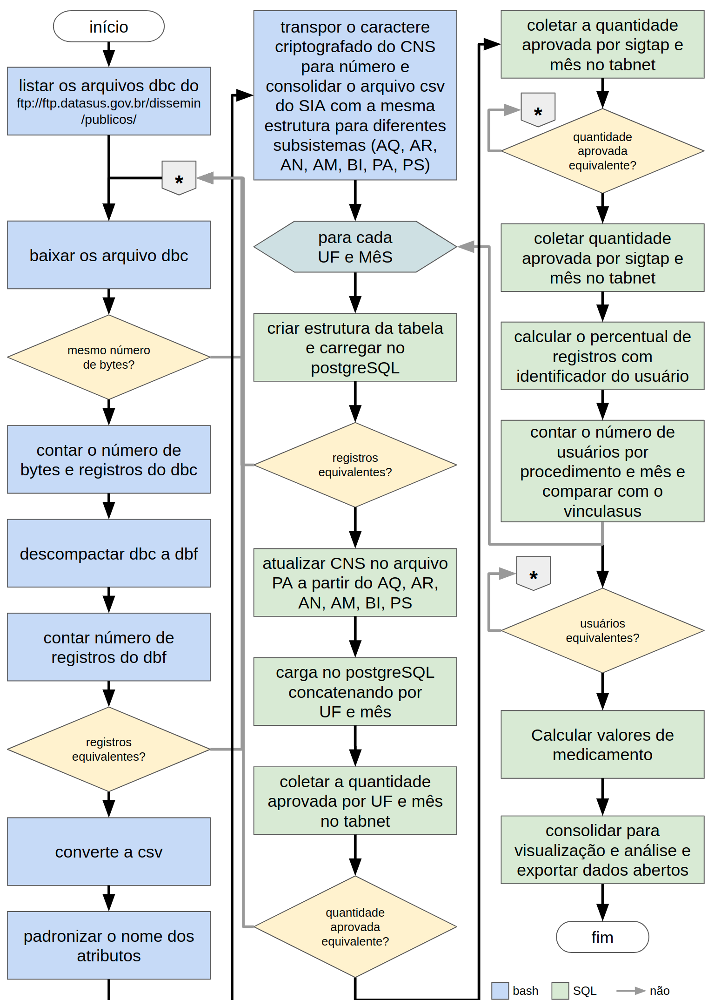

## Relatório técnico contendo descrição da validação do processo de Extração, Transformação e Carga de registros de dispensação de medicamentos regidos por Protocolo Clínico e Diretriz Terapêutica contidos na Sala Aberta de Inteligência em Saúde — SABEIS

::: {.callout-important title="Atualização institucional de 2026"}
Na organização vigente desta edição, a disseminação federal dos dados abertos do SUS é atribuída ao **DEMAS/SEIDIGI/MS**. Nomes institucionais anteriores permanecem somente quando descrevem o contexto histórico do relatório, documentos oficiais antigos, nomes próprios ou endereços técnicos legados.
:::

##### Equipe Sabeis

##### 19/04/2022


- [<span class="toc-section-number">1</span> Sumário executivo](#sumário-executivo)
- [<span class="toc-section-number">2</span> Introdução](#introdução)
  - [<span class="toc-section-number">2.1</span> Objetivos](#objetivos)
    - [<span class="toc-section-number">2.1.1</span> Objetivos específicos](#objetivos-específicos)
- [<span class="toc-section-number">3</span> Método](#método)
  - [<span class="toc-section-number">3.1</span> Recursos de software e hardware](#recursos-de-software-e-hardware)
  - [<span class="toc-section-number">3.2</span> Fonte de dados - repositório de dados abertos do SUS](#fonte-de-dados---repositório-de-dados-abertos-do-datasus)
  - [<span class="toc-section-number">3.3</span> Processamento](#processamento)
    - [<span class="toc-section-number">3.3.1</span> listar os arquivos dbc do ftp://ftp.datasus.gov.br/dissemin/publicos/](#listar-os-arquivos-dbc-do-ftpftp.datasus.gov.brdisseminpublicos)
    - [<span class="toc-section-number">3.3.2</span> baixar os arquivo dbc](#baixar-os-arquivo-dbc)
    - [<span class="toc-section-number">3.3.3</span> contar o número de bytes e registros do dbc](#contar-o-número-de-bytes-e-registros-do-dbc)
    - [<span class="toc-section-number">3.3.4</span> descompactar dbc a dbf](#descompactar-dbc-a-dbf)
    - [<span class="toc-section-number">3.3.5</span> contar número de registros do dbf](#contar-número-de-registros-do-dbf)
    - [<span class="toc-section-number">3.3.6</span> converte a csv](#converte-a-csv)
    - [<span class="toc-section-number">3.3.7</span> padronizar o nome dos atributos](#padronizar-o-nome-dos-atributos)
    - [<span class="toc-section-number">3.3.8</span> transpor o caractere criptografado do CNS para número e consolidar o arquivo csv do SIA com a mesma estrutura para diferentes subsistemas (AQ, AR, AN, AM, BI, PA, PS)](#transpor-o-caractere-criptografado-do-cns-para-número-e-consolidar-o-arquivo-csv-do-sia-com-a-mesma-estrutura-para-diferentes-subsistemas-aq-ar-an-am-bi-pa-ps)
    - [<span class="toc-section-number">3.3.9</span> criar estrutura da tabela e carregar no postgreSQL](#criar-estrutura-da-tabela-e-carregar-no-postgresql)
    - [<span class="toc-section-number">3.3.10</span> atualizar CNS no arquivo PA a partir do AQ, AR, AN, AM, BI, PS](#atualizar-cns-no-arquivo-pa-a-partir-do-aq-ar-an-am-bi-ps)
    - [<span class="toc-section-number">3.3.11</span> carga no postgreSQL concatenando por UF e mês](#carga-no-postgresql-concatenando-por-uf-e-mês)
- [<span class="toc-section-number">4</span> Resultados](#resultados)
  - [<span class="toc-section-number">4.1</span> Qualidade do download dos arquivos dbc](#qualidade-do-download-dos-arquivos-dbc)
  - [<span class="toc-section-number">4.2</span> Qualidade da descompactação DBC a DBF, transformação a CSV e carga no PostgreSQL](#qualidade-da-descompactação-dbc-a-dbf-transformação-a-csv-e-carga-no-postgresql)
  - [<span class="toc-section-number">4.3</span> Qualidade da extração de dispensações de medicamentos registradas em APAC na base Sabeis](#qualidade-da-extração-de-dispensações-de-medicamentos-registradas-em-apac-na-base-sabeis)
  - [<span class="toc-section-number">4.4</span> Quantidade aprovada por UF e mês em comparação ao tabnet](#quantidade-aprovada-por-uf-e-mês-em-comparação-ao-tabnet)
  - [<span class="toc-section-number">4.5</span> Número de usuários da SABEIS e do VinculaSUS](#número-de-usuários-da-sabeis-e-do-vinculasus)
- [<span class="toc-section-number">5</span> Considerações](#considerações)
- [<span class="toc-section-number">6</span> Referência](#referência)


## Sumário executivo

A tomada de decisão com base em dados do mundo real do SUS requer processos validados e extração, transformação e carga. A consolidação de dados de dispensação de medicamentos no escopo do Protocolos Clínicos e Diretrizes Terapêuticas (PCDT) requer a extração de bilhões de registros de dados ambulatoriais e conciliação com o código do usuário do SUS de modo a viabilizar estudos observacionais com dados administrativos. O objeto do presente produto foi descrever e avaliar o processo de Extração, Transformação e Carga dos dados de dispensação de medicamentos que compõe o repositório da Sala Aberta de Inteligência em Saúde - Sabeis. Os arquivos DBC foram processados em linguagem Bash e projeto R, modelados relacionalmente e carregados em Sistema Gerenciador de Banco de Dados, PostgreSQL. O processo foi validado em relação aos dados oficiais do TabNet e em relação aos dados pareados probabilisticamente via VINCULASUS, ferramenta do DataSUS ligada ao CADSUS, cadastro de usuários do SUS. Foram processados 27.509 arquivos DBC contendo 6.081.256.766 registros do SIA - Sistema de Informações Ambulatoriais do SUS, sendo relativos a 367 códigos de medicamentos dentre 12.934 procedimentos. O processo final resultou em 262.812.932 registros de dispensação de medicamentos com quantidade aprovada de 5.903.843.868. A validação em relação ao dados oficiais do TabNet resultou em 0 registros de diferença. O número de usuários-mês nos anos de 2019, 2020 e 2021 foram, respectivamente 17.123.469, 18.342.365 e 19.472.854, com uma correspondência de 89,8% a 98,9% com o VINCULASUS. Porém, considerando apenas registros identificados em ambas as bases pelo número da autorização e do estabelecimento de saúde, a correspondência foi de 99,8% a 100,0%. Considerou-se o método válido para utilização pela gestão de SUS e em estudos observacionais.


## Introdução

O uso dos medicamentos disponibilizados pelo SUS via Componente Especializado da Assistência Farmacêutica (CEAF) é regido pelo respectivo documento de Protocolos Clínicos e Diretrizes Terapêuticas (PCDT). A Secretaria de Ciência, Tecnologia, Inovação e Insumos Estratégicos em Saúde do Ministério da Saúde (SCTIE) por meio do Departamento de Gestão e Incorporação de Tecnologias e Inovação em Saúde (DGITIS) coordena o processo de formulação do PCDT e oferece suporte para incorporação e desincorporação de tecnologias no âmbito da Comissão Nacional de Incorporação de Tecnologias no SUS (CONITEC). Os medicamentos são disponibilizados pela assistência farmacêutica com atuação conjunta das três esferas federadas (municipal, estadual e federal). Contudo, as informações de transparência, isto é, com dados abertos no âmbito nacional, restringem-se ao Sistema de Informações Ambulatoriais, com foco em terapias de alto custo, não havendo dados abertos individualizados por usuário para a maior parde dos medicamentos adotados na atenção primária à saúde (Ferré et al. 2020; Ferré 2021).

O acesso a medicamentos do Componente Especializado é regulado via Portarias do Ministério da Saúde. Nas respectivas portarias constam o PCDT, o qual enquadra a doença nos diagnósticos segundo a CID10. Trabalhar com dados de mundo real com foco na demanda aferida é essencial para o planejamento do Sistema Único de Saúde. A demanda baseada em prevalência, segundo identificado na literatura, pode não estar atrelada à capacidade do sistema em diagnosticar, disponibilizar e dar acesso ao tratamento em todo o território. Para além das variáveis apresentadas em ensaios clínicos e revisões sistemáticas, a operacionalização do sistema de saúde é essencial para o sucesso do tratamento. Apenas a padronização, isto é, incorporação do tratamento no elenco, não implica na efetiva prevenção ou remissão da saúde da população devido à relação comercial do gestor com o Complexo Econômico-Industrial da Saúde, incluindo a cadeia logística e demais prestadores; educacional com os profissionais de saúde envolvidos na terapêutica e com o compromisso com usuário visando sua adesão (Perini et al. 1999). A cada incorporação, a cadeia assistencial de especialistas e instalações deve avaliada em cada território visando eficiência dos gastos públicos (Meiners et al. 2017).

Os sistemas assistenciais permanecem sob responsabilidade das áreas finalísticas, como a SAES/MS. Na organização institucional de 2026, os respectivos arquivos de dados abertos são disseminados pelo DEMAS/SEIDIGI/MS, inclusive em endereços técnicos legados como <ftp://ftp.datasus.gov.br/dissemin/publicos/>.

A Sala Aberta de Situação em Saúde é uma plataforma livre que viabiliza a gestão do conhecimento, análise e visualização de dados do SUS. A presente versão tabula dados de dispensação de medicamentos regulados por Protocolos Clínicos e Diretrizes Terapêuticas (PCDT) e classificados segundo a classificação mantida pelo SIGTAP - Sistema de Gerenciamento da Tabela de Procedimentos, Medicamentos e OPM do SUS. No presente relato são apresentados os processos para extração, transformação e carga dos dados que finalmente compõe o respositório para Avaliação de Tecnologias de Saúde (ATS).

O presente relato foi editado em R Markdown e está disponível em <https://rpubs.com/labxss/etlsabeis>.


### Objetivos

Descrever e avaliar o processo de Extração, Transformação e Carga dos dados de dispensação de medicamentos que compõe o repositório da Sala Aberta de Inteligência em Saúde - Sabeis.


#### Objetivos específicos

- Descrever a extração dos arquivos DBC disponibilizados via <ftp://ftp.datasus.gov.br/dissemin/publicos/>.
- Descrever a carga no Sistema Gerenciador de Banco de Dados (SGBD) PostgreSQL.
- Descrever a transformação para recomposição da quantidade aprovada e número do usuário do SUS.
- Descrever a exportação em dados tabulados CSV para uso como dado aberto sob a licença *Open Database License (ODbL)*.
- Apresentar o código-fonte disponível sob as licenças *General Public License* - GPL 3.014.
- Apresentar métricas de avaliação e avaliar os resultados do processo de formação do respositório


## Método


### Recursos de software e hardware

As agregações foram realizadas com Linguagem de Consulta Estruturada, (do inglês, Structured Query Language - SQL) sob os paradigmas da modelagem de processamento analítico online, do inglês, Online Analytical Processing (OLAP) e normas de nomenclatura do Departamento de Informática do SUS (DATASUS).

Os dados foram transpostos em tabelas de dimensão e fatos de modo que cada agregação constitui a soma simples da frequência e valores em Reais relativos a eventos discretos (procedimento, diagnóstico, território, características sociodemográficas). A performance de consultas foi otimizada com o recurso da desnormalização das tabelas fato, de modo a reduzir a demanda por cruzamentos com tabelas de dimensão.

A Extração, Transformação e Carga (extract, transform and load - ETL) de dados de dispensação de medicamentos de usuários com medicamentos biológicos em linguagem estruturada de consulta (structured query language - SQL) utilizando-se o Sistema Gerenciador de Banco de Dados (SGBD) PostgreSQL 10.10 (Ubuntu 10.10-0ubuntu0.18.04.1). Na wiki é disponibilizado o endereço para baixar o código-fonte e repositório de dados sob a licença General Public License - GPL 3.014 e Open Database License (ODbL).

Os dados foram processados em computador LG® Gram 7,6 GiB RAM, Intel® Core™ i7-7500U CPU @ 2.70GHz × 4, 256,1 GB SSD, Ubuntu 20.04.3 LTS.


### Fonte de dados - repositório de dados abertos do SUS

Em 2022, as duas principais estratégias de disseminação de dados abertos realizadas pelo Ministério da Saúde são:

- TabWin/TabNet: Arquivos de dados DBC do tipo DBF (database file) compactado, disponíveis em diretório FTP (protocolo de transferência de arquivos), com arquivos de descrição DEF do tipo texto (metadados) e domínios em CNV do tipo texto.
- OpenDataSUS: API (Interface de Programação de Aplicações) e arquivos de dados em formato CSV, do tipo texto e dicionário de dados em PDF com ou sem metatados e domínios.

A única fonte de dispensação de medicamentos individualizada por usuário do SUS é realizada desde 1994 via estratégia TabWin/TabNet.

A tabela [3.1](#tab:sistemas) informa os endereços onde são disponibilizados os arquivos DBC segundo sistema de informação. Os links FTP não são mais acessíveis em navegadores, devendo ser utilizadas ferramentas específicas para listar os arquivos dos diretórios.

| sistema | nome                                                                       | gestor  | url                                                                      |
|:--------|:---------------------------------------------------------------------------|:--------|:-------------------------------------------------------------------------|
| SIA     | SIA - Sistema de Informações Ambulatoriais do SUS de 1994 a 2007           | SAES/MS | <ftp://ftp.datasus.gov.br/dissemin/publicos/SIASUS/199407_200712/Dados/> |
| SIA     | SIA - Sistema de Informações Ambulatoriais do SUS a partir de 2008         | SAES/MS | <ftp://ftp.datasus.gov.br/dissemin/publicos/SIASUS/200801_/Dados/>       |
| SIH     | SIH - Sistema de Informações Hospitalares do SUS de 1992 a 2007            | SAES/MS | <ftp://ftp.datasus.gov.br/dissemin/publicos/SIHSUS/199201_200712/Dados/> |
| SIH     | SIH - Sistema de Informações Hospitalares do SUS a partir de 2008          | SAES/MS | <ftp://ftp.datasus.gov.br/dissemin/publicos/SIHSUS/200801_/Dados/>       |
| SIM     | SIM - Sistema de Informações de Mortalidade - Declarações de Óbitos Fetais | SVS/MS  | <ftp://ftp.datasus.gov.br/dissemin/publicos/SIM/CID10/DOFET/>            |
| SIM     | SIM - Sistema de Informações de Mortalidade                                | SVS/MS  | <ftp://ftp.datasus.gov.br/dissemin/publicos/SIM/CID10/DORES/>            |
| SINAN   | SINAN - Sistema de Informação de Agravos de Notificação                    | SVS/MS  | <ftp://ftp.datasus.gov.br/dissemin/publicos/SINAN/DADOS/FINAIS/>         |
| SISAB   | SISAB - Sistema de Informação em Saúde para a Atenção Básica               | SAPS/MS | <ftp://ftp.datasus.gov.br/dissemin/publicos/CMD/DadosSISAB/>             |
| PNI     | SIPNI - Programa Nacional de Imunizações                                   | SVS/MS  | <ftp://ftp.datasus.gov.br/dissemin/publicos/PNI/DADOS/>                  |

<span id="tab:sistemas">Table 3.1: </span>Diretórios onde são disponibilizados os arquivos DBC disseminados pelo DEMAS/SEIDIGI/MS.

A tabela [3.2](#tab:kbamostra) mostra exemplos de arquivos DBC dos diversos sistemas de informação disponíveis pela estratégia TabWin/TabNet.

|       no dbc |   dt dbc | sg sistema | sg subsistema | qt registros dbc local | qt bytes dbc |
|-------------:|---------:|-----------:|--------------:|-----------------------:|-------------:|
| ADPR1510.dbc | 16-11-07 |        SIA |            AD |                 14.395 |      834.012 |
| BIAL1611.dbc | 18-01-09 |        SIA |            BI |                130.574 |    5.412.470 |
| LTRS0605.dbc | 14-06-04 |       CNES |            LT |                  3.179 |       35.864 |
| EPBA2101.dbc | 21-02-22 |       CNES |            EP |                  8.265 |      294.299 |
| SRGO1911.dbc | 19-12-16 |       CNES |            SR |                 27.061 |      272.912 |
| PATO0912.dbc | 11-06-16 |        SIA |            PA |                123.692 |    2.062.053 |
| EFRS0711.dbc | 14-06-04 |       CNES |            EF |                     76 |        3.318 |
| ANSC0902.dbc | 11-06-20 |        SIA |            AN |                  2.004 |      148.791 |
| ARBA1703.dbc | 18-07-06 |        SIA |            AR |                  1.455 |      130.935 |
| GMES1105.dbc | 14-06-04 |       CNES |            GM |                      8 |        1.484 |
| EQTO1410.dbc | 16-08-09 |       CNES |            EQ |                  4.387 |       41.389 |
| RDCE0003.dbc | 13-10-31 |        SIH |            RD |                 48.725 |    1.803.947 |
| PAAC0409.dbc | 13-10-24 |        SIA |            PA |                 15.886 |      133.703 |
| HBDF1206.dbc | 16-08-09 |       CNES |            HB |                    277 |        7.724 |
| ADRO2010.dbc | 21-11-05 |        SIA |            AD |                    926 |       45.808 |
| PARS0002.dbc | 13-10-24 |        SIA |            PA |                220.274 |    2.181.116 |
| ADGO1103.dbc | 12-09-11 |        SIA |            AD |                 10.241 |      504.871 |
| RDAP1112.dbc | 13-11-01 |        SIH |            RD |                  3.214 |      207.681 |
| INSE2107.dbc | 21-08-18 |       CNES |            IN |                    126 |        4.137 |
| EESP1611.dbc | 16-12-14 |       CNES |            EE |                     51 |        2.739 |
| INBA1709.dbc | 17-11-22 |       CNES |            IN |                    312 |       12.243 |
| PADF1701.dbc | 18-07-07 |        SIA |            PA |                197.152 |    4.149.058 |
| GMAP0811.dbc | 14-06-04 |       CNES |            GM |                      1 |        1.100 |
| LTDF1406.dbc | 16-08-09 |       CNES |            LT |                    654 |        8.328 |
| RDRO0607.dbc | 13-10-31 |        SIH |            RD |                  7.992 |      438.972 |
| ANCE1407.dbc | 15-09-04 |        SIA |            AN |                    478 |       35.017 |
| DCSE1405.dbc | 16-08-09 |       CNES |            DC |                     18 |        6.705 |
| RCBA1604.dbc | 16-08-15 |       CNES |            RC |                    733 |       29.630 |
| HBGO1009.dbc | 14-06-04 |       CNES |            HB |                    431 |       13.031 |
| RCTO1908.dbc | 19-09-13 |       CNES |            RC |                    207 |        9.316 |

<span id="tab:kbamostra">Table 3.2: </span>Amostra de arquivos DBC disponíveis no repositório de disseminação do Ministério da Saúde

O dataSUS disponibilizou via **ftp**, em abril/2022, **13.191.018.300** registros em 142.828 arquivos DBC com dados de 01/1992 à 02/2022. A tabela [3.3](#tab:kbsumariodbc) resume o conteúdo disponível.

| sistema     | subsistema                                                                                                                                                                               | arquivos |           bytes |     registros | mes inicial | mes final |
|:------------|:-----------------------------------------------------------------------------------------------------------------------------------------------------------------------------------------|---------:|----------------:|--------------:|------------:|----------:|
| CIH         | CR                                                                                                                                                                                       |      868 |     165.114.178 |     7.676.888 |     01/2008 |   04/2011 |
| CIHA        | CIHA                                                                                                                                                                                     |    3.368 |   2.673.482.061 |   184.922.056 |     01/2011 |   12/2021 |
| CMD         | CT PR                                                                                                                                                                                    |    1.509 |  35.180.663.302 | 2.420.091.846 |     01/2017 |   04/2019 |
| CNES        | DC EE EF EFUFAA EP EQ GM GMUFAA HB HBUFAA IN INUFAA LT PF RC RCUFAA SR ST                                                                                                                |   63.521 |  35.475.426.148 |   925.102.283 |     08/2005 |   02/2022 |
| SIA         | AB ABO ACF AD AM AMP AN AQ AR ATD BI PA PS SAD                                                                                                                                           |   44.077 | 202.795.196.747 | 6.733.653.944 |     07/1994 |   01/2022 |
| SIH         | CH CM ER RD RJ SP                                                                                                                                                                        |   26.173 |  62.316.675.174 | 2.742.226.124 |     01/1992 |   01/2022 |
| SIM         | DO DOE DOF DOI DOM                                                                                                                                                                       |      777 |   2.492.961.184 |    36.349.670 |     12/1996 |   12/2020 |
| SINAN       | ACBI ACGR ANIM ANTR BOTU CANC CHAG CHIK COLE COQU DENG DERM DIFT ESQU FAMA FMAC FTIF HANS HANT IEXO LEIV LEPT LERD LTAN MALA MENI MENT PAIR PEST PFAN PNEU RAIV TETA TETN TUBE VIOL ZIKA |      804 |   1.681.733.836 |    38.435.335 |     12/2000 |   12/2020 |
| SINASC      | DN DNR                                                                                                                                                                                   |      787 |   3.679.826.930 |    96.968.941 |     12/1994 |   12/2020 |
| SISPRENATAL | PN                                                                                                                                                                                       |      944 |     232.410.320 |     5.591.213 |     01/2012 |   12/2014 |

<span id="tab:kbsumariodbc">Table 3.3: </span>Sumário dos arquivos DBC segundo o sistema de informação do SUS

Os dados são alimentados pelos municípios e encaminhados às Secretarias Estaduais de Saúde as quais enviam ao Ministério da Saúde para consolidação no **Sistema de Informações Ambulatoriais (SIA)**, sumarizados na tabela [3.4](#tab:kbsumariodbcsia).

| subsistema                                                                                                                                                                                                                                                                                                                                                                                                                              | arquivos |           bytes |     registros | mes inicial | mes final |
|:----------------------------------------------------------------------------------------------------------------------------------------------------------------------------------------------------------------------------------------------------------------------------------------------------------------------------------------------------------------------------------------------------------------------------------------|---------:|----------------:|--------------:|------------:|----------:|
| total                                                                                                                                                                                                                                                                                                                                                                                                                                   |   43.145 | 202.767.812.150 | 6.733.653.944 |     07/1994 |   01/2022 |
| PA                                                                                                                                                                                                                                                                                                                                                                                                                                      |    9.081 | 110.829.645.691 | 4.532.006.699 |     07/1994 |   01/2022 |
| BI                                                                                                                                                                                                                                                                                                                                                                                                                                      |    4.563 |  72.118.365.290 | 1.768.000.864 |     01/2008 |   01/2022 |
| AM                                                                                                                                                                                                                                                                                                                                                                                                                                      |    4.517 |  11.072.094.832 |   233.089.945 |     01/2008 |   01/2022 |
| PS                                                                                                                                                                                                                                                                                                                                                                                                                                      |    2.937 |   1.744.693.048 |    93.210.045 |     11/2012 |   01/2022 |
| AD                                                                                                                                                                                                                                                                                                                                                                                                                                      |    4.560 |   2.212.541.444 |    42.386.400 |     01/2008 |   01/2022 |
| AQ                                                                                                                                                                                                                                                                                                                                                                                                                                      |    4.529 |   3.328.180.337 |    41.501.281 |     01/2008 |   01/2022 |
| ATD                                                                                                                                                                                                                                                                                                                                                                                                                                     |    2.425 |     620.108.395 |     9.593.555 |     08/2014 |   01/2022 |
| AN                                                                                                                                                                                                                                                                                                                                                                                                                                      |    2.145 |     458.824.790 |     6.534.272 |     01/2008 |   10/2014 |
| SAD                                                                                                                                                                                                                                                                                                                                                                                                                                     |    1.088 |      53.440.628 |     3.524.141 |     04/2012 |   10/2018 |
| AR                                                                                                                                                                                                                                                                                                                                                                                                                                      |    4.110 |     293.926.401 |     3.330.346 |     01/2008 |   01/2022 |
| ACF                                                                                                                                                                                                                                                                                                                                                                                                                                     |    2.331 |      19.732.635 |       246.782 |     08/2014 |   01/2022 |
| AB                                                                                                                                                                                                                                                                                                                                                                                                                                      |      544 |      14.622.114 |       211.252 |     01/2008 |   04/2017 |
| AMP                                                                                                                                                                                                                                                                                                                                                                                                                                     |      315 |       1.636.545 |        18.362 |     03/2016 |   01/2022 |
| <span style="font-style: italic;">Note: </span>                                                                                                                                                                                                                                                                                                                                                                                         |          |                 |               |             |           |
|  AB Laudo de Acompanhamento à Cirurgia Bariátrica, ABO Acompanhamento Pós Cirurgia Bariátrica, ACF Laudo de Confecção de Fístula, AD Laudos Diversos, AM Laudo de Medicamentos, AMP Laudo de Acompanhamento Multiprofissional, AN Laudo de Nefrologia, AQ Laudo de Quimioterapia, AR Laudo de Radioterapia, ATD Laudo de Tratamento Dialítico, BI Boletim Individual, PA Produção Ambulatorial, PS Psicossocial, SAD Atenção Domiciliar |          |                 |               |             |           |

<span id="tab:kbsumariodbcsia">Table 3.4: </span>Sumário dos arquivos DBC do sistema de informação do Sistema de Informações Ambulatoriais (SIA)

O volume de dados a serem processados é sumarizado pela tabela [3.5](#tab:dadossia), sendo considerado os arquivos disponíveis a partir de 2008 dos subsistemas `PA`, `AM`, `AQ`, `AN`, `AR`, `BI` e `PS`, devido à presença do Cartão Nacional de Saúde cripitografado.

| uf                                                                                                                                                                                             | arquivos |           bytes |     registros | meses | mes inicial | mes final | gigabytes |
|:-----------------------------------------------------------------------------------------------------------------------------------------------------------------------------------------------|---------:|----------------:|--------------:|------:|------------:|----------:|----------:|
| AC                                                                                                                                                                                             |      970 |     375.328.936 |    13.793.135 |   169 |     01/2008 |   01/2022 |    0.3 GB |
| AL                                                                                                                                                                                             |    1.034 |   2.862.590.801 |    88.394.855 |   169 |     01/2008 |   01/2022 |    2.7 GB |
| AM                                                                                                                                                                                             |    1.029 |   2.789.493.714 |    91.773.322 |   169 |     01/2008 |   01/2022 |    2.6 GB |
| AP                                                                                                                                                                                             |      840 |     197.116.516 |     7.370.124 |   169 |     01/2008 |   01/2022 |    0.2 GB |
| BA                                                                                                                                                                                             |    1.035 |  10.762.422.605 |   333.202.269 |   169 |     01/2008 |   01/2022 |   10.0 GB |
| CE                                                                                                                                                                                             |    1.034 |   5.394.587.122 |   176.812.513 |   169 |     01/2008 |   01/2022 |    5.0 GB |
| DF                                                                                                                                                                                             |    1.030 |   1.605.385.749 |    53.393.937 |   169 |     01/2008 |   01/2022 |    1.5 GB |
| ES                                                                                                                                                                                             |    1.034 |   3.422.164.452 |   113.881.422 |   169 |     01/2008 |   01/2022 |    3.2 GB |
| GO                                                                                                                                                                                             |    1.034 |   4.295.286.910 |   133.491.735 |   169 |     01/2008 |   01/2022 |    4.0 GB |
| MA                                                                                                                                                                                             |    1.030 |   3.644.594.821 |   123.081.886 |   169 |     01/2008 |   01/2022 |    3.4 GB |
| MG                                                                                                                                                                                             |    1.037 |  24.387.563.414 |   743.740.388 |   169 |     01/2008 |   01/2022 |   22.7 GB |
| MS                                                                                                                                                                                             |    1.034 |   3.134.211.326 |   102.307.685 |   169 |     01/2008 |   01/2022 |    2.9 GB |
| MT                                                                                                                                                                                             |    1.033 |   2.804.187.716 |    86.829.316 |   169 |     01/2008 |   01/2022 |    2.6 GB |
| PA                                                                                                                                                                                             |    1.031 |   4.546.734.418 |   140.282.120 |   169 |     01/2008 |   01/2022 |    4.2 GB |
| PB                                                                                                                                                                                             |    1.032 |   3.770.080.779 |   122.920.396 |   169 |     01/2008 |   01/2022 |    3.5 GB |
| PE                                                                                                                                                                                             |    1.035 |   6.423.369.844 |   208.161.214 |   169 |     01/2008 |   01/2022 |    6.0 GB |
| PI                                                                                                                                                                                             |    1.033 |   1.920.491.760 |    62.058.121 |   169 |     01/2008 |   01/2022 |    1.8 GB |
| PR                                                                                                                                                                                             |    1.036 |  12.909.289.497 |   389.498.416 |   169 |     01/2008 |   01/2022 |   12.0 GB |
| RJ                                                                                                                                                                                             |    1.036 |  17.780.777.500 |   577.004.382 |   169 |     01/2008 |   01/2022 |   16.6 GB |
| RN                                                                                                                                                                                             |    1.023 |   2.597.503.284 |    79.538.772 |   169 |     01/2008 |   01/2022 |    2.4 GB |
| RO                                                                                                                                                                                             |    1.024 |   1.129.681.356 |    33.878.368 |   169 |     01/2008 |   01/2022 |    1.1 GB |
| RR                                                                                                                                                                                             |      832 |     231.361.658 |     7.859.555 |   169 |     01/2008 |   01/2022 |    0.2 GB |
| RS                                                                                                                                                                                             |    1.030 |  16.250.705.128 |   474.247.202 |   169 |     01/2008 |   01/2022 |   15.1 GB |
| SC                                                                                                                                                                                             |    1.032 |   9.461.777.488 |   281.251.535 |   169 |     01/2008 |   01/2022 |    8.8 GB |
| SE                                                                                                                                                                                             |    1.017 |   3.059.564.590 |    95.563.306 |   169 |     01/2008 |   01/2022 |    2.8 GB |
| SP                                                                                                                                                                                             |    1.182 |  47.071.885.250 | 1.508.000.868 |   169 |     01/2008 |   01/2022 |   43.8 GB |
| TO                                                                                                                                                                                             |      992 |     992.724.640 |    32.919.924 |   169 |     01/2008 |   01/2022 |    0.9 GB |
| total                                                                                                                                                                                          |   27.509 | 193.820.881.274 | 6.081.256.766 |   169 |     01/2008 |   01/2022 |  180.5 GB |
| <span style="font-style: italic;">Note: </span>                                                                                                                                                |          |                 |               |       |             |           |           |
|  Foram considerados: AM Laudo de Medicamentos, AN Laudo de Nefrologia, AQ Laudo de Quimioterapia, AR Laudo de Radioterapia, BI Boletim Individual, PA Produção Ambulatorial e PS Psicossocial. |          |                 |               |       |             |           |           |

<span id="tab:dadossia">Table 3.5: </span>Sumário dos arquivos DBC do sistema de informação do Sistema de Informações Ambulatoriais (SIA) processados na Sala Aberta de Inteligência em Saúde - SABEIS.

A justificativa para o processamento de 27.509 arquivos DBC contendo 6.081.256.766 registros, a partir de 2008, são:

- A organização dos procedimentos na tabela SIGTAP e
- A disponibilização do identificador do usuário do SUS.

Os 7.383 procedimentos do SUS, dentre ativos e inativos, são mantidos, desde 2008, via Sistema de Gerenciamento da Tabela de Procedimentos, Medicamentos e OPM do SUS (SIGTAP) coordenado pela Secretaria de Atenção Especializada à Saúde (SAES/MS) identificados por 12.934 códigos. Veja mais informações sobre o SIGTAP em <https://wiki.saude.gov.br/sigtap/index.php/P%C3%A1gina_principal>. A tabela [3.6](#tab:procedimentos) sumariza o quantitativo por grupo.

| grupo                                       | códigos | procedimentos |
|:--------------------------------------------|:--------|:--------------|
| 1 Ações de promoção e prevenção em saúde    | 91      | 70            |
| 2 Procedimentos com finalidade diagnóstica  | 1.039   | 847           |
| 3 Procedimentos clínicos                    | 753     | 581           |
| 4 Procedimentos cirúrgicos                  | 1.681   | 1.191         |
| 5 Transplantes de orgãos, tecidos e células | 135     | 105           |
| 6 Medicamentos                              | 367     | 357           |
| 7 Órteses, próteses e materiais especiais   | 529     | 426           |
| 8 Ações complementares da atenção à saúde   | 46      | 25            |

<span id="tab:procedimentos">Table 3.6: </span>Quantidade de procedimentos por grupo mantidos via Sistema de Gerenciamento da Tabela de Procedimentos, Medicamentos e OPM do SUS (SIGTAP)

Os códigos do grupo `medicamentos` iniciam com o dígito `6`. A tabela [3.7](#tab:kbbiologicos) exemplifica o elenco disponível. Observe que o mesmo medicamento pode apresentar historicamente mais de um código SIGTAP.

| sigla      | procedimento                                                                         | sigtap                                  |
|:-----------|:-------------------------------------------------------------------------------------|:----------------------------------------|
| ABAT125    | ABATACEPTE 125 MG INJETÁVEL (POR SERINGA PREENCHIDA)                                 | 604320140                               |
| ABAT250    | ABATACEPTE 250 MG INJETÁVEL (POR FRASCO AMPOLA).                                     | 604320124                               |
| ADAL40     | ADALIMUMABE 40 MG INJETAVEL (POR SERINGA PREENCHIDA)                                 | 601010019 604380011 604380062 604380097 |
| CERT200    | CERTOLIZUMABE PEGOL 200 MG/ML INJETÁVEL (POR SERINGA PREENCHIDA)                     | 604380070                               |
| CITR5      | CITRATO DE TOFACITINIBE 5 MG (POR COMPRIMIDO)                                        | 604320159                               |
| ETAN25     | ETANERCEPTE 25 MG INJETAVEL (POR FRASCO-AMPOLA)                                      | 601010027 604380020                     |
| ETAN50     | ETANERCEPTE 50 MG INJETAVEL (POR FRASCO-AMPOLA OU SERINGA PREENCHIDA)                | 601010051 604380038                     |
| ETAN50A    | ETANERCEPTE 50 MG INJETÁVEL (POR FRASCO-AMPOLA OU SERINGA PREENCHIDA)(BIOSSIMILAR A) | 604380100                               |
| FING05     | FINGOLIMODE 0.5 MG (POR CÁPSULA)                                                     | 604320132                               |
| GOLI50     | GOLIMUMABE 50 MG INJETÁVEL (POR SERINGA PREENCHIDA                                   | 604380089                               |
| INFL1010   | INFLIXIMABE 10 MG/ML INJETAVEL (POR FRASCO-AMPOLA COM 10 ML)                         | 601010035 601010043 604380046 604380054 |
| RITU50050  | RITUXIMABE 500 MG INJETÁVEL (POR FRASCO-AMPOLA DE 50 ML)                             | 604680023                               |
| RITU50050A | RITUXIMABE 500 MG INJETÁVEL (POR FRASCO- AMPOLA DE 5O ML ) (BIOSSIMILAR A)           | 604680031                               |
| SECU150    | SECUQUINUMABE 150 MG/ML SOLUÇÃO INJETÁVEL (POR SERINGA PREENCHIDA)                   | 604690029                               |
| TOCI204    | TOCILIZUMABE 20 MG/ML INJETAVEL (POR FRASCO-AMPOLA DE 4 ML)                          | 604690010                               |
| USTEQ45    | USTEQUINUMABE 45 MG/0,5ML SOLUÇÂO INJETÀVEL (POR SERINGA PREENCHIDA)                 | 604690037                               |
| VEDO300    | VEDOLIZUMABE 300 MG PÓ LIOFILIZADO PARA SOLUÇĂO INJETÁVEL                            | 604320167                               |

<span id="tab:kbbiologicos">Table 3.7: </span>Exemplos de medicamentos e respectivos códigos SIGTAP

A formação do repositório completo do SIA é necessária para obtenção das dispensações de medicamentos, presentes simultaneamente na tabela do tipo `AM` e na do tipo `PA`.

Nas tabelas do tipo `AM` encontram-se os códigos do usuário do SUS, no formato criptografado do Cartão Nacional de Saúde, porém sem a quantidade aprovada de unidades farmacoténicas. Nas tabelas do tipo `PA` encontram-se as quantidades aprovadas de unidades farmacotécnicas, entretando, sem o código de identificação do usuário do SUS. Ambas devem ser correlacionadas segundo o

- número da autorização da guia **APAC - Autorização para Procedimentos de Alto Custo/Complexidade**,
- código da gestão (usualmente da Secretaria Estadual de Saúde) ou do estabelecimento e
- mês de competência.

Adicionalmente, existem tabelas expressivas como a `BI`, as quais contém o CNS criptografado que podem enriquecer os arquivos PA.

A seguir, são descritas as etapas para extrair o arquivo DBC, recuperar o CNS criptografado nos arquivos `PA` e organizar os dados em repositório estruturado utilizando um Sistema Gerenciador de Banco de Dados (SGBD).


### Processamento

O resumo do método é ilustrado na figura [3.1](#fig:fluxograma). A extração, transformação e carga (do inglês, *Extract, Transform, Load* - ETL) foi realizada via algoritmos em linguagem GNU bash, versão 4.4.20, com carga no Sistema Gerenciador de Banco de Dados (SGBD) PostgreSQL 10.8. Na organização institucional de 2026, os dados em formato DBC são disseminados pelo DEMAS/SEIDIGI/MS em endereço técnico legado disponível em <ftp://ftp.datasus.gov.br>.




Figure 3.1: Etapas realizadas na Sala Aberta de Inteligência em Saúde - SABEIS no processamento dos dados abertos do SUS.


#### listar os arquivos dbc do <ftp://ftp.datasus.gov.br/dissemin/publicos/>

Dentre os 142.828 arquivos DBC disponíveis, foram processados 27.509 arquivos na presente versão do repositório SABEIS referentes ao Sistema de Informações Ambulatoriais *SIA*.

Os comandos a seguir, em linguagem `bash`, nativa dos sistemas operalcionais `Linux`, são executados para listagem e tratamento dos arquivos diponíveis utilizando-se o comando `curl URL`.

A partir no nome do arquivo DBC são derivados o subsistema, o estado (UF), ano e o mês de competência, conforme o exemplo `PARO1506`

- `PA`: Produção Ambulatorial a qual corresponde o arquivo do “corpo” da APAC, as demais siglas dos subsistemas são `AB` Laudo de Acompanhamento à Cirurgia Bariátrica, `ABO` Acompanhamento Pós Cirurgia Bariátrica, `ACF` Laudo de Confecção de Fístula, `AD` Laudos Diversos, `AM` Laudo de Medicamentos, `AMP` Laudo de Acompanhamento Multiprofissional, `AN` Laudo de Nefrologia, `AQ` Laudo de Quimioterapia, `AR` Laudo de Radioterapia, `ATD` Laudo de Tratamento Dialítico, `BI` Boletim Individual, `PS` Psicossocial e `SAD` Atenção Domiciliar.
- UF, a saber: Acre - AC (12), Alagoas - AL (27), Amazonas - AM (13), Amapá - AP (16), Bahia - BA (29), Ceará - CE (23), Distrito Federal - DF (53), Espírito Santo - ES (32), Goiás - GO (52), Maranhão - MA (21), Minas Gerais - MG (31), Mato Grosso do Sul - MS (50), Mato Grosso - MT (51), Pará - PA (15), Paraíba - PB (25), Pernambuco - PE (26), Piauí - PI (22), Paraná - PR (41), Rio de Janeiro - RJ (33), Rio Grande do Norte - RN (24), Rondônia - RO (11), Roraima - RR (14), Rio Grande do Sul - RS (43), Santa Catarina - SC (42), Sergipe - SE (28), São Paulo - SP (35), Tocantins - TO (17).
- Ano com dois dígidos e mês de competência.

``` bash
# codigo bash: 

# data atual
curdt=$(date '+%Y%m%d')

# lista arquivos da pasta do SIA, transpoe e salva no arquivo csv
curl ftp://ftp.datasus.gov.br/dissemin/publicos/SIASUS/200801_/Dados/ | 
egrep -i "dbc$" | awk '{print $4","$3","$1","$2}' | 
awk -F'[-,]' '{print $1","$2","$5"-"$3"-"$4","$6",SIA"}' > 
/tmp/listadbc.ftp.$curdt.p1.csv 

# obtem sistema e uf a partir do nome do arquivo
cat /tmp/listadbc.ftp.$curdt.p1.csv | sed 's/a\.dbc/\.dbc/g' | 
sed 's/b\.dbc/\.dbc/g' | sed 's/c\.dbc/\.dbc/g' | 
awk -F'.' '{print toupper($1)}' | sed 's/[^A-Z]//g' |
awk '{print substr($1,1,length($1)-2)","substr($1,length($1)-1,length($1))}' > 
/tmp/listadbc.ftp.$curdt.p2.csv
cat /tmp/listadbc.ftp.$curdt.p1.csv | sed 's/a\.dbc/\.dbc/g' | 
sed 's/b\.dbc/\.dbc/g' | sed 's/c\.dbc/\.dbc/g' | awk -F'.' '{print $1}' | 
sed 's/[^0-9]//g' > /tmp/listadbc.ftp.$curdt.p3.csv
paste -d, /tmp/listadbc.ftp.$curdt.p1.csv /tmp/listadbc.ftp.$curdt.p2.csv /tmp/listadbc.ftp.$curdt.p3.csv | 
awk -F',' -v OFS=',' '{ x=$8; if ( length($8) == 2 ) { if ( $8 > 80 ) $8="19"$8; else $8="20"$8}; print $0 }' | 
awk -F',' -v OFS=',' '{if ( $7 == "XT" ) $7 = "BR"; print $0}' | 
awk -F',' -v OFS=',' '{if ( $7 == "ET" ) $7 = "BR"; print $0}' | 
awk -F',' -v OFS=',' '{if ( $7 == "NF" ) $7 = "BR"; print $0}' | 
awk -F',' -v OFS=',' '{if ( $7 == "AT" ) $7 = "BR"; print $0}' > 
/tmp/listadbc.ftp.$curdt.p4.csv

# obtem competencia e ano a partir do nome do arquivo
aamm=",CIH,|,CIHA,|,CMD,|,CNES,|,SIA,|,SIH,|,SISPRENATAL,"
aaaa="SIM,DO|,SINASC,DN,|SINASC,DNR,"
aa=",SIM,DOI,|,SIM,DOE,|,SIM,DOF,|,SIM,DOM,|,SINAN,|"
cat /tmp/listadbc.ftp.$curdt.p4.csv | 
awk -F',' -v OFS=',' '{ if ( $5 == "CIH" || $5 == "CIHA" || $5 == "CNES" ||
$5 == "SIA" || $5 == "SIH" || $5 == "SISPRENATAL" || $5 == "CMD" ) { if ( substr($8,1,2) > 80 ) $8="19"$8; else $8="20"$8 } else $8=$8"12"; print $0","substr($8,1,4)  }' > /tmp/$log.csv
```


#### baixar os arquivo dbc

Cada arquivo DBC deve ser baixado a partir do repositório, atualmente com 180.5 GB (27.509 arquivos DBC) do total de 322.9 GB disponível (142.828 arquivos DBC).

Uma vez processado e carregado no banco de dados estruturado, o arquivo DBC pode ser eliminado.

``` bash
# codigo bash: 
# baixa todos os arquivos dbc da pasta indicada 
# ignorando a caixa (alta ou baixa) --ignore-case 
# e os arquivos baixados anteriormente --no-clobber
wget --ignore-case --no-clobber ftp://ftp.datasus.gov.br/dissemin/publicos/SIASUS/200801_/Dados/*.dbc
```


#### contar o número de bytes e registros do dbc

A contagem do número de registros e bytes é fundamental para comparar com o listado (presente) da FTP, uma vez que os arquivos podem variar de 1.6 KB a 234.8 MB, podendo haver falhas no download.

``` bash
# codigo bash: complementa a lista de arquivos com o numero de registros do dbc local 
touch /tmp/listadbc.ftp.$curdt.tmp; rm /tmp/listadbc.ftp.$curdt.tmp
for line in $(cat /tmp/$log.csv);do
  fdbc=$(echo $line | awk -F',' '{print $1}')
  b=$(ls -ln $dirdbc/$fdbc | awk '{print $5}')
  r=$(dbview -i -o $dirdbc/$fdbc | grep recs | awk '{print $NF}')
  echo "$line,$b,$r" >> /tmp/listadbc.ftp.$curdt.tmp
done

mv /tmp/listadbc.ftp.$curdt.tmp /tmp/$log.1.csv
```

A fim de viabilizar o monitoramento da qualidade da extração, a lista de arquivos DBC e o trajeto ao longo do processamento é registrada no banco de dados.

``` bash
# codigo bash: Persiste no PostgreSQL
sed 's/$/,0/g' /tmp/$log.1.csv | awk -F'.' '{print tolower($1)","$0}' > /tmp/$log.csv

echo "
        DROP TABLE IF EXISTS $log;
        CREATE TABLE $log (
            no_origem  varchar(100) default null,
            no_dbc varchar(100) default null,
            qt_bytes_dbc int8 default 0,
            dt_dbc varchar(10) default null,
            hs_dbc varchar(10) default null,
            sg_sistema varchar(100) default null, 
            sg_subsistema varchar(100) default null, 
            sg_uf char(2) default null,
            nu_competencia int4 default 0,
            nu_ano int4 default 0,
            qt_bytes_dbc_local int8 default 0,
            qt_registros_dbc_local int8 default 0 ,            
            qt_registros_sql_local int8 default 0
        ); " | PGPASSWORD=$PSQL_PWD psql -U $PSQL_USR -h $PSQL_HOST -d $PSQL_DB -p $PSQL_PORT 

PGPASSWORD=$PSQL_PWD psql -U $PSQL_USR -h $PSQL_HOST -d $PSQL_DB -p $PSQL_PORT  -c \
    "COPY $log FROM STDIN delimiter ',' csv" \
    < /tmp/$log.csv

# indexa
echo "CREATE UNIQUE INDEX tf_coleta_${curdt}_idx ON $log (no_origem);" | 
PGPASSWORD=$PSQL_PWD psql -U $PSQL_USR -h $PSQL_HOST -d $PSQL_DB -p $PSQL_PORT
```

Havendo divergências de bytes do arquivo local em relação ao FTP, o mesmo é eliminado do disco, vindo a ser novamenta baixado numa próxima iteração.

``` bash
# codigo bash: elimina dbc com numero de bytes diferentes
  echo "select no_dbc from $log where qt_bytes_dbc <> qt_bytes_dbc_local" | 
  PGPASSWORD=$PSQL_PWD psql -U $PSQL_USR -h $PSQL_HOST -d $PSQL_DB -p $PSQL_PORT -t | 
  grep -i dbc | sed 's/^/rm/g' | sh
```


#### descompactar dbc a dbf

O executável oficial, historicamente fornecido pelo Ministério da Saúde é o `dbf2dbc.exe`, o qual pode ser baixado em <http://siab.datasus.gov.br/DATASUS/index.php?area=060805&item=3>, ou diretamente pelo link <ftp://ftp.datasus.gov.br/tabwin/tabwin/Tab415.zip>.

Ele está contido no arquivo `Tab415.zip`, na versão 4.15 para Microsoft® Windows®. O código-fonte do `TabWin` e do `dbf2dbc.exe` não foi disponibilizado pelo Ministério da Saúde, nem há refatoração oficial em software livre do compactador/descompactador e do compilador de arquivos de definição *DEF* e domínios *CNV*. No método SABEIS, o executável é usado por meio do `wine`, que oferece uma camada de compatibilidade com aplicações MS-Windows.

Entretanto, existem iniciativas, implementadas em `R`, a saber:

- `read.dbc`, vide em <https://github.com/danicat/read.dbc>.
- microdatasus, vide em <https://github.com/rfsaldanha/microdatasus>.

A opção por utilizar a ferramenta oficial historicamente distribuída pelo Ministério da Saúde deve-se à velocidade e reprodutibilidade com que os arquivos são processados em linguagem `bash`, sobretudo no processamento de bilhões de registros em computadores domésticos.

``` bash
# codigo bash: descompactador DBC para DBF
exe="Tab415/dbf2dbc.exe"
dbc="PABA1903" # ARQUIVO dbc APAC da Bahia, de marco/2019 

# descompacta dbc para dbf
wine $exe $fdbc

# identifica o arquivo dbf
fdbf=$(echo $fdbc  | awk -F'.' '{print "ls "$1"* | grep -i DBF"}' | sh)
```


#### contar número de registros do dbf

O reconhecimento da do sucesso da descompctação deve-se à contagem do número de registros do dbf e comparação com os do dbc.

``` bash
# codigo bash: numero de registros do arquivo dbf
r=$(dbview -i -o $fdbc | grep recs | awk '{print $NF}')
```


#### converte a csv

O csv é um formato universal de arquivo tabulado, tornando dinâmico o processamento do arquivo cujo uso em dbf se torna restrito a ferramentas específicas capazes de lidar com o formato.

``` bash
# codigo bash: converte dbf em csv
dbview -b -d"^" -t $fdbf | iconv -f "CP861" -t "UTF-8" | sed 's/"//g' | sed 's/\\//g' | awk -F'^' -v n=$lcol '{if (NF == n) print $0}'  > /tmp/tmp.$curdt.csv
```


#### padronizar o nome dos atributos

A partir da estrutura do arquivo dbf são selecionados os campos, os quais podem apresentar variações do nome ao longo dos diferentes subsistemas do SIA. A tabela [3.5](#tab:dadossia) relaciona os campoo e os diferentes subsistemas onde podem ser apontados atributos correlados.

| atributo                          | origem                                                                                                                                                                                                                                                                                                                                                                                                                                                                                                                                                                                                                                                                                                                                                                                                                                                                                                                                                                                                                                                                                                                                                                                                                                                                                                                                                   | tipo        | descrição                                                                                                                                                                                                                                                                            |
|:----------------------------------|:---------------------------------------------------------------------------------------------------------------------------------------------------------------------------------------------------------------------------------------------------------------------------------------------------------------------------------------------------------------------------------------------------------------------------------------------------------------------------------------------------------------------------------------------------------------------------------------------------------------------------------------------------------------------------------------------------------------------------------------------------------------------------------------------------------------------------------------------------------------------------------------------------------------------------------------------------------------------------------------------------------------------------------------------------------------------------------------------------------------------------------------------------------------------------------------------------------------------------------------------------------------------------------------------------------------------------------------------------------|:------------|:-------------------------------------------------------------------------------------------------------------------------------------------------------------------------------------------------------------------------------------------------------------------------------------|
| co_cid_principal                  | CIHA.CIHA.diag_princ; CIH.CR.diag_princ; SIA.AB.ap_cidpri; SIA.ACF.ap_cidpri; SIA.AD.ap_cidpri; SIA.AM.ap_cidpri; SIA.AMP.ap_cidpri; SIA.AN.ap_cidpri; SIA.AQ.ap_cidpri; SIA.AR.ap_cidpri; SIA.ATD.ap_cidpri; SIA.BI.cidpri; SIA.PA.pa_cidpri; SIA.PS.cidpri; SIA.SAD.cidpri; SIH.RD.diag_princ; SIH.RJ.diag_princ; SIH.SP.sp_cidpri; SIM.DO.causabas; SIM.DOE.causabas; SIM.DOF.causabas; SIM.DOI.causabas; SIM.DOM.causabas                                                                                                                                                                                                                                                                                                                                                                                                                                                                                                                                                                                                                                                                                                                                                                                                                                                                                                                            | varchar(8)  | CID Principal;CID Principal (APAC ou BPA-I)                                                                                                                                                                                                                                          |
| co_cid_secundario                 | CIHA.CIHA.diag_secun; CIH.CR.diag_secun; SIA.AB.ap_cidsec; SIA.ACF.ap_cidsec; SIA.AD.ap_cidsec; SIA.AM.ap_cidsec; SIA.AMP.ap_cidsec; SIA.AN.ap_cidsec; SIA.AQ.ap_cidsec; SIA.AR.ap_cidsec; SIA.ATD.ap_cidsec; SIA.PA.pa_cidsec; SIA.PS.cidassoc; SIA.SAD.cidassoc; SIH.RD.cid_asso; SIH.RD.cid_morte; SIH.RD.cid_notif; SIH.RD.diag_sec; SIH.RD.diagsec1; SIH.RD.diagsec2; SIH.RD.diagsec3; SIH.RD.diagsec4; SIH.RD.diagsec5; SIH.RD.diagsec6; SIH.RD.diagsec7; SIH.RD.diagsec8; SIH.RD.diagsec9; SIH.RD.diag_secun; SIH.RJ.cid_asso; SIH.RJ.cid_morte; SIH.RJ.cid_notif; SIH.RJ.diag_secun; SIH.SP.sp_cidsec; SIM.DO.causabas_o; SIM.DO.causamat; SIM.DOE.causabas_o; SIM.DOE.causamat; SIM.DOE.linhaii; SIM.DOF.causabas_o; SIM.DOF.causamat; SIM.DOF.linhaii; SIM.DOI.causabas_o; SIM.DOI.causamat; SIM.DOI.linhaii; SIM.DO.linhaii; SIM.DOM.causabas_o; SIM.DOM.causamat; SIM.DOM.linhaii                                                                                                                                                                                                                                                                                                                                                                                                                                                            | varchar(30) | CID Causas Associadas;CID Secundário;CID Secundário (APAC)                                                                                                                                                                                                                           |
| co_ibge_municipio_estabelecimento | CIHA.CIHA.munic_mov; CIH.CR.munic_mov; CNES.DC.codufmun; CNES.EE.codufmun; CNES.EF.codufmun; CNES.EP.codufmun; CNES.EQ.codufmun; CNES.GM.codufmun; CNES.HB.codufmun; CNES.IN.codufmun; CNES.LT.codufmun; CNES.PF.codufmun; CNES.RC.codufmun; CNES.SR.codufmun; CNES.ST.codufmun; SIA.AB.ap_ufmun; SIA.ACF.ap_ufmun; SIA.AD.ap_ufmun; SIA.AM.ap_ufmun; SIA.AMP.ap_ufmun; SIA.AN.ap_ufmun; SIA.AQ.ap_ufmun; SIA.AR.ap_ufmun; SIA.ATD.ap_ufmun; SIA.BI.ufmun; SIA.PA.pa_munat; SIA.PA.pa_ufmun; SIA.PS.ufmun; SIA.SAD.ufmun; SIH.RD.munic_mov; SIH.RJ.munic_mov; SIM.DO.codmunocor; SIM.DOE.codmunocor; SIM.DOF.codmunocor; SIM.DOI.codmunocor; SIM.DOM.codmunocor; SINAN.ANIM.id_municip; SINAN.BOTU.id_municip; SINAN.CHAG.id_municip; SINAN.CHIK.id_municip; SINAN.COLE.id_municip; SINAN.COQU.id_municip; SINAN.DENG.id_municip; SINAN.DIFT.id_municip; SINAN.ESQU.id_municip; SINAN.FAMA.id_municip; SINAN.FMAC.id_municip; SINAN.FTIF.id_municip; SINAN.HANS.id_municip; SINAN.HANT.id_municip; SINAN.IEXO.id_municip; SINAN.LEIV.id_municip; SINAN.LEPT.id_municip; SINAN.LTA.id_municip; SINAN.LTAN.id_municip; SINAN.MALA.id_municip; SINAN.MENI.id_municip; SINAN.PEST.id_municip; SINAN.PFA.id_municip; SINAN.RAIV.id_municip; SINAN.TETA.id_municip; SINAN.TETN.id_municip; SINAN.TUBE.id_municip; SINAN.VIOL.id_municip; SINAN.ZIKA.id_municip | int4        | Unidade da Federação + Município do Estabelecimento;Unidade da Federação + município onde está localizado o Estabelecimento;Unidade Federação do Brasil                                                                                                                              |
| co_ibge_municipio_residencia      | CIHA.CIHA.munic_res; CIH.CR.munic_res; CMD.CT.co_munres; CMD.PR.co_munres; CNES.PF.ufmunres; SIA.AB.ap_munpcn; SIA.ACF.ap_munpcn; SIA.AD.ap_munpcn; SIA.AM.ap_munpcn; SIA.AMP.ap_munpcn; SIA.AN.ap_munpcn; SIA.AQ.ap_munpcn; SIA.AR.ap_munpcn; SIA.ATD.ap_munpcn; SIA.BI.munpac; SIA.PA.pa_munpcn; SIA.PS.munpac; SIA.SAD.munpac; SIH.ER.mun_res; SIH.RD.munic_res; SIH.RJ.munic_res; SIM.DO.codmunres; SIM.DOE.codmunres; SIM.DOF.codmunres; SIM.DOI.codmunres; SIM.DOM.codmunres; SINASC.DN.codmunres                                                                                                                                                                                                                                                                                                                                                                                                                                                                                                                                                                                                                                                                                                                                                                                                                                                  | int4        | ;UF + Município de Residência do paciente;Unidade da Federação + município do município de residência do paciente;Unidade da Federação + município do município de residência do paciente ou do estabelecimento, caso não se tenha à identificação do paciente o que ocorre no (BPA) |
| co_procedimento                   | CIHA.CIHA.proc_rea; CIH.CR.proc_rea; CMD.CT.co_procede; CMD.PR.co_procede; SIA.AB.ap_pripal; SIA.ACF.ap_pripal; SIA.AD.ap_pripal; SIA.AM.ap_pripal; SIA.AMP.ap_pripal; SIA.AN.ap_pripal; SIA.AQ.ap_pripal; SIA.AR.ap_pripal; SIA.ATD.ap_pripal; SIA.BI.proc_id; SIA.PA.pa_codpro; SIA.PA.pa_proc_id; SIA.PS.pa_proc_id; SIA.SAD.pa_proc_id; SIH.RD.proc_rea; SIH.RJ.proc_rea; SIH.SP.sp_procrea                                                                                                                                                                                                                                                                                                                                                                                                                                                                                                                                                                                                                                                                                                                                                                                                                                                                                                                                                          | int8        | Código de Procedimento Ambulatorial;Procedimento Principal da APAC                                                                                                                                                                                                                   |
| dt_nascimento                     | CIHA.CIHA.nasc; CIH.CR.nasc; SIA.BI.dtnasc; SIA.PS.dtnasc; SIA.SAD.dtnasc; SIH.RD.nasc; SIH.RJ.nasc; SIM.DO.dtnasc; SIM.DOE.dtnasc; SIM.DOF.dtnasc; SIM.DOI.dtnasc; SIM.DOM.dtnasc; SINASC.DN.dtnasc; SINASC.DNR.data_nasc                                                                                                                                                                                                                                                                                                                                                                                                                                                                                                                                                                                                                                                                                                                                                                                                                                                                                                                                                                                                                                                                                                                               | int8        | Data de nascimento do Paciente                                                                                                                                                                                                                                                       |
| nu_autorizacao                    | SIA.AB.ap_autoriz; SIA.ACF.ap_autoriz; SIA.AD.ap_autoriz; SIA.AM.ap_autoriz; SIA.AMP.ap_autoriz; SIA.AN.ap_autoriz; SIA.AQ.ap_autoriz; SIA.AR.ap_autoriz; SIA.ATD.ap_autoriz; SIA.BI.autoriz; SIA.PA.pa_autoriz; SIA.PA.pa_numapa                                                                                                                                                                                                                                                                                                                                                                                                                                                                                                                                                                                                                                                                                                                                                                                                                                                                                                                                                                                                                                                                                                                        | int8        | Número da APAC;Número da APAC ou número de autorização do BPA-I, conforme o caso. No BPA-I não é obrigatório, portanto, não é criticado.                                                                                                                                             |
| nu_idade                          | CIHA.CIHA.idade; CIH.CR.idade; SIA.AB.ap_nuidade; SIA.ACF.ap_nuidade; SIA.AD.ap_nuidade; SIA.AM.ap_nuidade; SIA.AMP.ap_nuidade; SIA.AN.ap_nuidade; SIA.AQ.ap_nuidade; SIA.AR.ap_nuidade; SIA.ATD.ap_nuidade; SIA.BI.idadepac; SIA.PA.pa_idade; SIA.PS.idadepac; SIA.SAD.idadepac; SIH.RD.idade; SIH.RJ.idade; SIM.DOE.idade; SIM.DOF.idade; SIM.DO.idade; SIM.DOI.idade; SIM.DOM.idade; SINAN.ANIM.nu_idade_n; SINAN.BOTU.nu_idade_n; SINAN.CHAG.nu_idade_n; SINAN.CHIK.nu_idade_n; SINAN.COLE.nu_idade_n; SINAN.COQU.nu_idade_n; SINAN.DENG.nu_idade_n; SINAN.DIFT.nu_idade_n; SINAN.ESQU.nu_idade_n; SINAN.FAMA.nu_idade_n; SINAN.FMAC.nu_idade_n; SINAN.FTIF.nu_idade_n; SINAN.HANS.nu_idade_n; SINAN.HANT.nu_idade_n; SINAN.IEXO.nu_idade_n; SINAN.LEIV.nu_idade_n; SINAN.LEPT.nu_idade_n; SINAN.LTAN.nu_idade_n; SINAN.LTA.nu_idade_n; SINAN.MALA.nu_idade_n; SINAN.MENI.nu_idade_n; SINAN.PEST.nu_idade_n; SINAN.PFA.nu_idade_n; SINAN.RAIV.nu_idade_n; SINAN.TETA.nu_idade_n; SINAN.TETN.nu_idade_n; SINAN.TUBE.nu_idade_n; SINAN.VIOL.nu_idade_n; SINAN.ZIKA.nu_idade_n; SISPRENATAL.PN.nu_idade                                                                                                                                                                                                                                                 | int8        | Idade do Paciente em anos;Numero da Idade                                                                                                                                                                                                                                            |
| qt_aprovada                       | CIHA.CIHA.dias_perm; CIH.CR.dias_perm; SIA.BI.qt_aprov; SIA.PA.pa_qtdapr; SIA.PS.pa_qtdapr; SIA.SAD.pa_qtdapr; SIH.RD.dias_perm; SIH.RD.qt_diarias; SIH.RJ.dias_perm; SIH.RJ.qt_diarias; SIH.SP.sp_qtd_ato                                                                                                                                                                                                                                                                                                                                                                                                                                                                                                                                                                                                                                                                                                                                                                                                                                                                                                                                                                                                                                                                                                                                               | int8        | Quantidade Aprovada;Quantidade aprovada do procedimento                                                                                                                                                                                                                              |
| sg_sexo                           | CIHA.CIHA.sexo; CIH.CR.sexo; CMD.CT.co_sexo; CMD.PR.co_sexo; SIA.AB.ap_sexo; SIA.ACF.ap_sexo; SIA.AD.ap_sexo; SIA.AM.ap_sexo; SIA.AMP.ap_sexo; SIA.AN.ap_sexo; SIA.AQ.ap_sexo; SIA.AR.ap_sexo; SIA.ATD.ap_sexo; SIA.BI.sexopac; SIA.PA.pa_sexo; SIA.PS.sexopac; SIA.SAD.sexopac; SIH.RD.sexo; SIH.RJ.sexo; SIM.DOE.sexo; SIM.DOF.sexo; SIM.DOI.sexo; SIM.DOM.sexo; SIM.DO.sexo; SINAN.ANIM.cs_sexo; SINAN.BOTU.cs_sexo; SINAN.CHAG.cs_sexo; SINAN.CHIK.cs_sexo; SINAN.COLE.cs_sexo; SINAN.COQU.cs_sexo; SINAN.DENG.cs_sexo; SINAN.DIFT.cs_sexo; SINAN.ESQU.cs_sexo; SINAN.FAMA.cs_sexo; SINAN.FMAC.cs_sexo; SINAN.FTIF.cs_sexo; SINAN.HANS.cs_sexo; SINAN.HANT.cs_sexo; SINAN.IEXO.cs_sexo; SINAN.LEIV.cs_sexo; SINAN.LEPT.cs_sexo; SINAN.LTA.cs_sexo; SINAN.LTAN.cs_sexo; SINAN.MALA.cs_sexo; SINAN.MENI.cs_sexo; SINAN.PEST.cs_sexo; SINAN.PFA.cs_sexo; SINAN.RAIV.cs_sexo; SINAN.TETA.cs_sexo; SINAN.TUBE.cs_sexo; SINAN.VIOL.cs_sexo; SINAN.ZIKA.cs_sexo; SINASC.DNR.sexo; SINASC.DN.sexo                                                                                                                                                                                                                                                                                                                                                            | varchar(1)  | Sexo;Sexo (0=3, M=1, F=2);Sexo do Paciente                                                                                                                                                                                                                                           |

<span id="tab:atributos">Table 3.8: </span>Atributos relacionados no SIA e respectivo nome padronizado

Entretanto, não são carregados todos os atributos do SIA, apenas os adotados na Avaliação de Tecnologias em Saúde até o presente momento.

``` bash
# codigo bash: estrutura do dbf
dbview -e -o $fdbf | 
    awk -F'\t' '{ gsub(/[ \t]+$/,"",$1);gsub(" ","_",$1); print tolower($1)","$2","$3}' | 
    sed 1d | sed 's/ //g' | nl | awk '{print $1","$2}' > $fstr

# numero de colunas 
lcol=$(tail -1 $fstr | awk -F',' '{print $1+1}')

# posicao das colunas
nu_apac=$(cat $fstr | egrep -i ",ap_autoriz,|,autoriz,|,nu_autorizacao,|,pa_autoriz,|,pa_numapa,|,ap_autoriz," | head -1 | awk -F','  '{print $1}');
nu_apac_anterior=$(cat $fstr | egrep -i "apacant," | head -1 | awk -F','  '{print $1}')
nu_cnspcn=$(cat $fstr | egrep -i ",ap_cnspcn,|,cns_pac,|,nu_cnspcn," | head -1 | awk -F','  '{print $1}')
co_procedimento=$(cat $fstr | egrep -i "ap_pripal,|,co_procede,|,pa_proc_id,|,proc_id,|,proc_rea,|,sp_procrea,|,pa_codpro," | head -1 | awk -F','  '{print $1}')
co_gestao=$(cat $fstr | egrep -i ",ap_gestao,|,gestao,|,pa_gestao,|,uf_zi,|,sp_gestor," | head -1 | awk -F','  '{print $1}')
co_ibge_municipio_residencia=$(cat $fstr | egrep -i ",ap_munpcn,|,codmunres,|,co_munres,|,munic_res,|,munpac,|,mun_res,|,pa_munpcn,|,ufmunres," | head -1 | awk -F','  '{print $1}')
co_cep_residencia=$(cat $fstr | egrep -i ",cep,|,ap_ceppcn," | head -1 | awk -F','  '{print $1}')
co_carater_atendimento=$(cat $fstr | egrep -i "catend," | head -1 | awk -F','  '{print $1}')
sg_sexo=$(cat $fstr | egrep -i "ap_sexo,|,co_sexo,|,cs_sexo,|,pa_sexo,|,sexo,|,sexopac," | head -1 | awk -F','  '{print $1}')
nu_idade=$(cat $fstr | egrep -i "ap_nuidade,|,idade,|,idadepac,|,nu_idade_n,|,pa_idade," | head -1 | awk -F','  '{print $1}')
co_motivo_saida=$(cat $fstr | egrep -i "motsai," | head -1 | awk -F','  '{print $1}')
co_ibge_municipio_evento=$(cat $fstr | egrep -i ",ap_ufmun,|,codufmun,|,id_municip,|,munic_mov,|,pa_ufmun,|,ufmun,|,codmunocor,|,pa_munat," | head -1 | awk -F','  '{print $1}')
dt_inicio=$(cat $fstr | egrep -i ",ap_dtinic,|,dt_inter,|,sp_dtinter,|,ap_dtocor,|,dt_atend,|,inicio,|,ant_dt_aci,|,dt_inter," | head -1 | awk -F','  '{print $1}')
dt_fim=$(cat $fstr | egrep -i ",dt_saida,|,sp_dtsaida,|,ap_dtfim,|,fim," | head -1 | awk -F','  '{print $1}')
co_cnes_estabelecimento=$(cat $fstr | egrep -i ",ap_coduni,|,cnes,|,cnes_exec,|,co_cnescon,|,coduni,|,id_unidade,|,pa_coduni,|,sp_cnes,|,sp_cnes," | head -1 | awk -F','  '{print $1}')
co_cidpri=$(cat $fstr | egrep -i ",ap_cidpri,|,causabas,|,cidpri,|,diag_princ,|,pa_cidpri,|,sp_cidpri," | head -1 | awk -F','  '{print $1}')
co_cidsec=$(cat $fstr | egrep -i ",ap_cidsec,|,diag_sec,|,diagsec1,|,diagsec2,|,diagsec3,|,diagsec4,|,diagsec5,|,diagsec6,|,diagsec7,|,diagsec8,|,diagsec9,|,diag_secun,|cidsec,|,sp_cidsec," | head -1 | awk -F','  '{print $1}')
qt_aprovada=$(cat $fstr | egrep -i ",pa_qtdapr,|,qt_aprov," | head -1 | awk -F','  '{print $1}')
vl_aprovado=$(cat $fstr | egrep -i ",pa_valapr,|,qt_proced,|,val_tot,|,vl_aprov," | head -1 | awk -F','  '{print $1}')
pa_condic=$(cat $fstr | egrep -i ",pa_condic,|,ap_condic,|,condic," | head -1 | awk -F','  '{print $1}')
```


#### transpor o caractere criptografado do CNS para número e consolidar o arquivo csv do SIA com a mesma estrutura para diferentes subsistemas (AQ, AR, AN, AM, BI, PA, PS)

Nessa etapa são transpostos os caracteres especiais contidos na chave criptofráfica do CNS para números escolhidos aleatoreamente. Dessa forma, não há referência direta ao CNS verdadeiro do usuário do SUS.

``` bash
# codigo bash: obtem csv com campos selecionados e converte caracteres do CNS criptografado
  paste -d, <(cat /tmp/tmp.$curdt.csv | sed 's/[^0-9\^]//g' | awk -F'^' -v uf=$uf -v nu_apac=$nu_apac -v nu_apac_anterior=$nu_apac_anterior -v co_procedimento=$co_procedimento -v co_gestao=$co_gestao -v co_ibge_municipio_residencia=$co_ibge_municipio_residencia -v co_cep_residencia=$co_cep_residencia -v co_carater_atendimento=$co_carater_atendimento -v nu_idade=$nu_idade -v co_motivo_saida=$co_motivo_saida -v co_ibge_municipio_evento=$co_ibge_municipio_evento -v dt_inicio=$dt_inicio -v dt_fim=$dt_fim -v co_cnes_estabelecimento=$co_cnes_estabelecimento -v qt_aprovada=$qt_aprovada -v d=$cmp '{print d","uf"," $nu_apac"," $nu_apac_anterior"," $co_procedimento","$co_gestao","$co_ibge_municipio_residencia"," $co_cep_residencia","$co_carater_atendimento"," $nu_idade"," $co_motivo_saida"," $co_ibge_municipio_evento"," $dt_inicio","$dt_fim"," $co_cnes_estabelecimento"," $qt_aprovada}'   ) <(cat /tmp/tmp.$curdt.csv | awk -F'^' -v vl_aprovado=$vl_aprovado '{print $vl_aprovado}' | iconv -f "CP861" -t "UTF-8" | sed 's/[^0-9\.]//g' ) <(cat /tmp/tmp.$curdt.csv | awk -F'^' -v nu_cnspcn=$nu_cnspcn '{print $nu_cnspcn}' | sed 's/{/0/g' | sed 's/}/9/g' | sed 's/~/8/g' | sed 's/ /7/g' | sed 's/Ç/6/g' | sed 's/ä/5/g' | sed 's/ü/4/g' | sed 's/é/3/g' | sed 's/|/2/g' | sed 's/â/1/g' | sed 's/[^0-9]/ /g'  | sed 's/ /4/g') <(cat /tmp/tmp.$curdt.csv | awk -F'^' -v sg_sexo=$sg_sexo -v co_cidpri=$co_cidpri -v co_cidsec=$co_cidsec -v pa_condic=$pa_condic -v o=$origem '{print substr($sg_sexo,1,1)"," substr($co_cidpri,1,4)"," substr($co_cidsec,1,50)","substr($pa_condic,1,2)","o}' | sed 's/0000//g') | sort -h > /tmp/tmp.$curdt.x.csv 

mv /tmp/tmp.$curdt.x.csv /tmp/tmp.$curdt.csv
```


#### criar estrutura da tabela e carregar no postgreSQL

A partir do arquivo csv devidamente processado e com as colunas ordenadas, é possível fazer a carga no banco de dados.

As variáveis `$schema` e `$tb`, indicam respectivamente o banco e a tabela onde serão armazenados cada arquivo dbc.

Os schemas são organizados segundo os sistemas e subsistemas.

``` bash
# codigo bash: cria tabela no postgreSQL para armazenar o DBC
  echo "drop table if exists $schema.$tb;
  create table if not exists $schema.$tb (
    nu_competencia int4 NULL,
    sg_uf char(2) default null,
    nu_apac int8 NULL,
    nu_apac_anterior int8 NULL,
    co_procedimento int8 NULL,
    co_gestao int8 NULL,
    co_ibge_municipio_residencia int4 NULL,
    co_cep_residencia int4 NULL,
    co_carater_atendimento int8 NULL,
    nu_idade int4 NULL,
    co_motivo_saida int2 NULL,
    co_ibge_municipio_evento int4 NULL,
    dt_inicio int8 NULL,
    dt_fim int8 NULL,
    co_cnes_estabelecimento int4 NULL,
    qt_aprovada int8 NULL,
    vl_aprovado float8 NULL,
    nu_cnspcn int8 NULL,
    sg_sexo bpchar(1) NULL,
    co_cidpri bpchar(4) NULL,
    co_cidsec varchar(50) NULL,
    sg_tipo_gestao char(2) default null,
    no_origem varchar(20) NULL,
    vl_aprovado_ipca decimal(12,4) default null
);

COMMENT ON TABLE $schema.$tb IS 'coleta registrada em $log.';
COMMENT ON COLUMN $schema.$tb.vl_aprovado_ipca IS 'IPCA referente a ${cmpn}';
" | PGPASSWORD=$pw psql -U $us -h $hs -d $dbase -p $pt

# adotado quando existem arquivos a, b e c para o mesmo estado e mes
echo "DELETE FROM $schema.$tb WHERE no_origem='$origem'" | PGPASSWORD=$pw psql -U $us -h $hs -d $dbase -p $pt

# realiza a carga do csv no postgreSQL
PGPASSWORD=$pw psql -U $us -h $hs -d $dbase -p $pt  -c \
"COPY $schema.$tb (nu_competencia, sg_uf, nu_apac, nu_apac_anterior, co_procedimento, co_gestao, co_ibge_municipio_residencia, co_cep_residencia, co_carater_atendimento,  nu_idade, co_motivo_saida, co_ibge_municipio_evento, dt_inicio, dt_fim, co_cnes_estabelecimento, qt_aprovada, vl_aprovado, nu_cnspcn, sg_sexo, co_cidpri, co_cidsec, sg_tipo_gestao, no_origem) FROM STDIN quote '\"' delimiter ',' csv " \
    < /tmp/tmp.$curdt.csv
    
```


#### atualizar CNS no arquivo PA a partir do AQ, AR, AN, AM, BI, PS

Para cada arquivo `PA` (`$tb1`) e respectivos demais subsistemas da mesma UF e mês, são resgatados os cartões quando o número da apac e o cnes de estabelecimento são os mesmos.

``` bash
# codigo bash: atualiza cns
    echo "update $tb1 A 
         set nu_cnspcn = B.nu_cnspcn
        from $tb2 B
       where A.co_cnes_estabelecimento = B.co_cnes_estabelecimento 
         and A.nu_apac = B.nu_apac 
         and B.nu_cnspcn > 0
         and A.nu_apac > 0;" | 
         PGPASSWORD=$pw psql -U $us -h $hs -d $dbase -p $pt -e 
         
       # atualiza log do PA
     echo "update $log A
            set qt_cnspcn    = B.qt_cnspcn,
                qt_aprovada  = B.qt_aprovada,
                vl_aprovado  = B.vl_aprovado,                
                qt_registros = B.qt_registros
           from (select COUNT(distinct nu_cnspcn) qt_cnspcn,
                        sum(qt_aprovada) qt_aprovada,
                        sum(vl_aprovado) vl_aprovado,
                        count(*) qt_registros 
                   from $tb1
                 ) B
         where A.no_origem = split_part('$tb2','.',2)" | 
PGPASSWORD=$pw psql -U $us -h $hs -d $dbase -p $pt          
```


#### carga no postgreSQL concatenando por UF e mês

Embora a operação possa ser realizada inteiramente num servidor, optou-se por manter o SIA completo e o extrato de medicamentos da SABEIS em máquinas distintas, a primeira física e a segunda em nuvem.

Inicialmente, são inseridas as informações dos arquivos novos em uma tabela de controle de qualidade chamada `bd_medicamento.tf_coleta_medicamento`.

``` bash
# codigo bash: atualiza tabela de log
query0="insert into bd_medicamento.tf_coleta_medicamento
  select 'bd_medicamento_' || nu_ano as no_schema,
         lower('pa' || sg_uf || nu_competencia::text) as no_tabela,
         sg_uf ,
         nu_competencia ,
         string_agg(distinct case when sg_subsistema = 'PA' then no_dbc else null end, ' ') as no_dbc_pa, 
         max(case when split_part(dt_dbc,'-',1)::int > 70 
            then (19 || dt_dbc)::DATE
            else (20 || dt_dbc)::DATE
         end) as dt_dbc,
         current_date as dt_carga_sabeis,
         sum(case when sg_subsistema = 'PA' then qt_bytes_dbc else 0 end) as qt_bytes_dbc_pa, 
         sum(case when sg_subsistema = 'PA' then qt_registros_dbc_local else 0 end) as qt_registros_dbc_local_pa,
         string_agg(distinct case when sg_subsistema = 'AM' then no_dbc else null end, ' ') as no_dbc_am, 
         sum(case when sg_subsistema = 'AM' then qt_bytes_dbc else 0 end) as qt_bytes_dbc_am, 
         sum(case when sg_subsistema = 'AM' then qt_registros_dbc_local else 0 end) as qt_registros_dbc_local_am         
    from $log
   where sg_subsistema in ('PA','AM')
     and sg_sistema = 'SIA'
     and nu_ano >= 2008
     and lower('pa' || sg_uf || nu_competencia::text) not in (select distinct no_tabela from bd_medicamento.tf_coleta_medicamento)
   group by 1,2,3,4
   order by 1,2,3 ;"
   
   echo $query0  | PGPASSWORD=$pw2 psql -U $us2 -h $hs2 -d $dbase2 -p $pt2 
```

Para cada um dos arquivos `PA` da respectiva UF e competência é dada a carga do servidor físico para o servidor em nuvem, apenas dos procedimentos que iniciam com o dígido `6`, relativos a medicamentos.

``` bash
# codigo bash: exporta do servidor fisico para o em nuvem
    query2="drop table if exists ${no_schema}.${no_tabela}; 
            create table ${no_schema}.${no_tabela} () inherits (bd_medicamento.tf_dispensacao)"
    echo $query2 | PGPASSWORD=$pw2 psql -U $us2 -h $hs2 -d $dbase2 -p $pt2 -e        


   query3="SELECT no_tabela_sql as tb
  FROM $log
  where sg_uf = '$sg_uf'
    and nu_competencia = $nu_competencia
    and sg_subsistema = 'PA'"

    for origem in $(echo $query3 | PGPASSWORD=$pw1 psql -U $us1 -h $hs1 -d $dbase1 -p $pt1 -t --csv);do
            
      query4="select co_procedimento, co_cidpri, nu_cnspcn, nu_idade, sg_sexo, qt_aprovada, 
    co_cnes_estabelecimento , co_ibge_municipio_evento , co_ibge_municipio_residencia , co_cidsec, nu_apac 
    , nu_competencia , sg_uf
      from $origem where substr(co_procedimento::text,1,1)='6' "        
            
      echo $query4 | PGPASSWORD=$pw1 psql -U $us1 -h $hs1 -d $dbase1 -p $pt1 --csv -t | 
      PGPASSWORD=$pw2 psql -U $us2 -h $hs2 -d $dbase2 -p $pt2  -c \
    "COPY ${no_schema}.${no_tabela} (co_procedimento, co_cidpri, nu_usuariosus, nu_idade, sg_sexo, qt_aprovada, 
    co_cnes, co_municipio_ibge, co_municipio_ibge_residencia, co_cidsec, nu_apac, nu_competencia , sg_uf) 
        FROM STDIN quote '\"' delimiter ',' csv "        
            
     done
```


## Resultados


### Qualidade do download dos arquivos dbc

A tabela [4.1](#tab:kbdownload) indica o quantitativo de arquivos e o valor em bytes do presente no diretório FTP em relação ao presente no disco local.

|  ano | arquivos |   qt bytes dbc | qt bytes dbc local | diferença absoluta | diferença percentual |
|-----:|---------:|---------------:|-------------------:|-------------------:|---------------------:|
| 2008 |    1.893 |  5.463.007.078 |      5.463.007.078 |                  0 |                    0 |
| 2009 |    1.902 |  5.304.910.422 |      5.304.910.422 |                  0 |                    0 |
| 2010 |    1.913 |  6.356.939.347 |      6.356.939.347 |                  0 |                    0 |
| 2011 |    1.915 |  8.395.878.634 |      8.395.878.634 |                  0 |                    0 |
| 2012 |    1.930 | 14.205.825.400 |     14.205.825.400 |                  0 |                    0 |
| 2013 |    2.245 |  7.213.895.524 |      7.213.895.524 |                  0 |                    0 |
| 2014 |    2.128 |  8.829.094.814 |      8.829.094.814 |                  0 |                    0 |
| 2015 |    1.916 | 10.102.851.329 |     10.102.851.329 |                  0 |                    0 |
| 2016 |    1.915 | 12.373.978.530 |     12.373.978.530 |                  0 |                    0 |
| 2017 |    1.915 | 17.917.231.674 |     17.917.231.674 |                  0 |                    0 |
| 2018 |    1.910 | 21.983.170.731 |     21.983.170.731 |                  0 |                    0 |
| 2019 |    1.919 | 25.158.819.209 |     25.158.819.209 |                  0 |                    0 |
| 2020 |    1.917 | 21.107.678.526 |     21.107.678.526 |                  0 |                    0 |
| 2021 |    1.934 | 27.146.187.292 |     27.146.187.292 |                  0 |                    0 |
| 2022 |      157 |  2.261.412.764 |      2.261.412.764 |                  0 |                    0 |

<span id="tab:kbdownload">Table 4.1: </span>Número de arquivos DBC do Sistema de Informações Ambulatoriais (SIA), quantidade de bytes no servidor e quantidade de bytes no disco local para ser processado e incorporado na Sala Aberta de Inteligência em Saúde - SABEIS

Não houve divergência em relação ao númerode bytes dos arquivos listados do FTP em relação ao baixado.


### Qualidade da descompactação DBC a DBF, transformação a CSV e carga no PostgreSQL

A tabela [4.2](#tab:kbregistros) indica o quantitativo de registros apresentados no arquivo DBC antes de ser descompactado em relação ao incorporado no PostgreSQL.

|  ano | arquivos | arquivo divergente | qt registros dbc local | qt registros sql local | diferença absoluta | diferença percentual | subsistema divergente |
|-----:|---------:|-------------------:|-----------------------:|-----------------------:|-------------------:|---------------------:|----------------------:|
| 2008 |    1.893 |                  3 |            199.607.878 |            196.898.938 |          2.708.940 |                 0.68 |                 AM PA |
| 2009 |    1.902 |                  0 |            230.418.437 |            230.418.437 |                  0 |                 0.00 |                       |
| 2010 |    1.913 |                  1 |            248.291.846 |            248.291.845 |                  1 |                 0.00 |                    AQ |
| 2011 |    1.915 |                  0 |            300.010.269 |            300.010.269 |                  0 |                 0.00 |                       |
| 2012 |    1.930 |                  0 |            310.257.502 |            310.257.502 |                  0 |                 0.00 |                       |
| 2013 |    2.245 |                  0 |            344.186.857 |            344.186.857 |                  0 |                 0.00 |                       |
| 2014 |    2.128 |                  0 |            381.516.710 |            381.516.710 |                  0 |                 0.00 |                       |
| 2015 |    1.916 |                  0 |            407.264.477 |            407.264.477 |                  0 |                 0.00 |                       |
| 2016 |    1.915 |                  0 |            460.027.416 |            460.027.416 |                  0 |                 0.00 |                       |
| 2017 |    1.915 |                  0 |            587.984.070 |            587.984.070 |                  0 |                 0.00 |                       |
| 2018 |    1.910 |                  0 |            605.627.340 |            605.627.340 |                  0 |                 0.00 |                       |
| 2019 |    1.919 |                  0 |            668.112.361 |            668.112.361 |                  0 |                 0.00 |                       |
| 2020 |    1.917 |                  0 |            556.387.939 |            556.387.939 |                  0 |                 0.00 |                       |
| 2021 |    1.934 |                  0 |            722.952.210 |            722.952.210 |                  0 |                 0.00 |                       |
| 2022 |      157 |                  0 |             58.611.454 |             58.611.454 |                  0 |                 0.00 |                       |

<span id="tab:kbregistros">Table 4.2: </span>Registros contidos em DBC do Sistema de Informações Ambulatoriais (SIA), quantidade de bytes no servidor e quantidade de bytes no disco local para ser processado e incorporado na Sala Aberta de Inteligência em Saúde - SABEIS

A extração de dados tabulados e a carga em bases estruturadas demanda que exista consistência com o número de colunas e do validação dos valores conforme o domínio de cada atributo. Dessa forma, são desconsiderados registros inválidos.


### Qualidade da extração de dispensações de medicamentos registradas em APAC na base Sabeis

O número de registros no servidor em nuvem relativos a medicamentos foi 262.812.932.

Na formação da base de medicametnos foram processados, em abril/2022, 6.081.256.766 registros em 27.509 arquivos DBC com dados de 01/2008 à 01/2022 na extração dos dados da base SIA PA para a formação do repositório Sabeis. Foram identificados 58 arquivos discrepantes (PAAC2112.dbc PAAC2201.dbc PAAL2112.dbc PAAL2201.dbc PAAM2112.dbc PAAM2201.dbc PAAP2112.dbc PAAP2201.dbc PABA2112.dbc PABA2201.dbc PACE2112.dbc PACE2201.dbc PADF2112.dbc PADF2201.dbc PAES2112.dbc PAES2201.dbc PAGO2112.dbc PAGO2201.dbc PAMA2112.dbc PAMA2201.dbc PAMG2112.dbc PAMG2201.dbc PAMS2112.dbc PAMS2201.dbc PAMT2112.dbc PAMT2201.dbc PAPA2112.dbc PAPA2201.dbc PAPB2112.dbc PAPB2201.dbc PAPE2112.dbc PAPE2201.dbc PAPI2112.dbc PAPI2201.dbc PAPR2112.dbc PAPR2201.dbc PARJ2112.dbc PARJ2201.dbc PARN2112.dbc PARN2201.dbc PARO2112.dbc PARO2201.dbc PARR2112.dbc PARR2201.dbc PARS2112.dbc PARS2201.dbc PASC2112.dbc PASC2201.dbc PASE2112.dbc PASE2201.dbc PASP2112a.dbc PASP2112b.dbc PASP2112c.dbc PASP2201a.dbc PASP2201b.dbc PASP2201c.dbc PATO2112.dbc PATO2201.dbc), isto é, com mais de 1% de variação, representando, no conjunto, 2.911.785 registros.


### Quantidade aprovada por UF e mês em comparação ao tabnet

A coleta do arquivo csv gerado pelo tabnet é realizada com os seguintes parâmtros a partir do tabulador <http://tabnet.datasus.gov.br/cgi/tabcgi.exe?sia/cnv/qauf.def>.

- ano e mes de processamento
- `por UF`
- `quantidade aprovada`
- grupo de procedimento `06`

A [planilha](https://docs.google.com/spreadsheets/d/1lnZsswLNEe1_2YbV95MZLM8ECl_seP-f9xpgBptcxZI/edit?usp=sharing) contém o resultado da extração do sítio do `TabNet` por UF e mês. O algoritmo `bash` para a verificação junto ao tabnet é mostrado a seguir.

``` bash
# bash

# controle de qualidade UF, MES, quantidade aprovada
echo "drop table if exists bd_sabeis.tf_medicamento_qualidade_uf_mes;
 create table bd_sabeis.tf_medicamento_qualidade_uf_mes as
select B.sg_uf, nu_competencia ,
       DENSE_RANK () OVER (ORDER BY nu_competencia) co_seq_competencia
  from (select distinct nu_competencia from bd_sabeis.tf_medicamento) A,
       bd_geral.td_estado B
       order by 1,2;

 alter table bd_sabeis.tf_medicamento_qualidade_uf_mes
 add qt_aprovada int8 default 0;
 
 update bd_sabeis.tf_medicamento_qualidade_uf_mes A
    set qt_aprovada = B.qt_aprovada
   from (
 select sg_uf,
        nu_competencia,
        sum(qt_aprovada) qt_aprovada
   from bd_sabeis.tf_medicamento M
  group by 1,2
  order by 1,2
  ) B
  where A.nu_competencia = B.nu_competencia
  and A.sg_uf = B.sg_uf;
  
  ALTER TABLE bd_sabeis.tf_medicamento_qualidade_uf_mes ADD qt_aprovada_tabnet int8 default 0;
  "| PGPASSWORD=$pw2 psql -U $us2 -h $hs2 -d $dbase2 -p $pt2 -e

# planilha do tabnet
url="https://docs.google.com/spreadsheets/d/1lnZsswLNEe1_2YbV95MZLM8ECl_seP-f9xpgBptcxZI/edit?usp=sharing"
echo "library(gsheet);ds=as.data.frame(gsheet2tbl('$url', sheetid = 1)); library(RPostgreSQL); con = DBI::dbConnect(dbDriver(drvName = 'PostgreSQL'),  dbname = '$dbase2', host = '$hs2', port = $pt2, user = '$us2', password = '$pw2');dbWriteTable(con, c('bd_sabeis','tm_tabnet_medicamento_uf_mes'), ds, overwrite = TRUE )" | R --vanilla


for uf in $(echo "select sg_uf from bd_geral.td_estado "| PGPASSWORD=$pw2 psql -U $us2 -h $hs2 -d $dbase2 -p $pt2 -t --csv);do
   echo " update bd_sabeis.tf_medicamento_qualidade_uf_mes A
    set qt_aprovada_tabnet = \"${uf}\"
   from bd_sabeis.tm_tabnet_medicamento_uf_mes B
   where nu_competencia = replace(left(\"Ano/mês processamento\"::text,7),'-','')::INT
   and sg_uf = '${uf}'"| PGPASSWORD=$pw2 psql -U $us2 -h $hs2 -d $dbase2 -p $pt2 -e
done

# erro geral
echo "alter table bd_sabeis.tf_medicamento_qualidade_uf_mes add vl_erro float default 0;
update bd_sabeis.tf_medicamento_qualidade_uf_mes  
   set vl_erro = round(ABS(qt_aprovada_tabnet - qt_aprovada)::DECIMAL/(qt_aprovada+qt_aprovada_tabnet)*100,1)
   where qt_aprovada > 0
"| PGPASSWORD=$pw2 psql -U $us2 -h $hs2 -d $dbase2 -p $pt2 -e
```

As tabelas [4.3](#tab:qtaprtabnet) e [4.4](#tab:qtaprtabnet2) indicam a quantidade aprovada presente na Sabeis em relação ao divulgado via tabnet por mês e UF.

|  ano | arquivos | qt aprovada sabeis | qt aprovada tabnet | diferença absoluta | diferença percentual | nu competencia min | nu competencia max |
|-----:|---------:|-------------------:|-------------------:|-------------------:|---------------------:|-------------------:|-------------------:|
| 2016 |      216 |        590.051.667 |        590.051.667 |                  0 |                    0 |             201605 |             201612 |
| 2017 |      324 |        925.916.483 |        925.916.483 |                  0 |                    0 |             201701 |             201712 |
| 2018 |      324 |        975.316.986 |        975.316.986 |                  0 |                    0 |             201801 |             201812 |
| 2019 |      324 |      1.022.200.782 |      1.022.200.782 |                  0 |                    0 |             201901 |             201912 |
| 2020 |      324 |      1.127.084.548 |      1.127.084.548 |                  0 |                    0 |             202001 |             202012 |
| 2021 |      324 |      1.172.558.283 |      1.172.558.283 |                  0 |                    0 |             202101 |             202112 |
| 2022 |       27 |         90.715.119 |         90.715.119 |                  0 |                    0 |             202201 |             202201 |

<span id="tab:qtaprtabnet">Table 4.3: </span>Quantidade aprovada de medicamentos registradas no Sistema de Informações Ambulatoriais (SIA) incorporado na Sala Aberta de Inteligência em Saúde - SABEIS e divulgadas via Tabnet

Verificou-se, entre 05/2016 e 01/2022, 5.903.843.868 de quantidade aprovada persistida na SABEIS, enquanto, no tabnet, o valor foi de 5.903.843.868 (diferença de 0 registros).

|                                                                  sg uf | nu competencia | qt aprovada | qt aprovada tabnet |     media |    desvio |    ic min |    ic max |   n |
|-----------------------------------------------------------------------:|---------------:|------------:|-------------------:|----------:|----------:|----------:|----------:|----:|
|                                                                     AC |         201808 |           0 |                  0 |   106.535 |   106.089 |    10.932 |   202.138 |   5 |
|                                                                     AC |         201810 |           0 |                  0 |   118.114 |   117.570 |    12.164 |   224.063 |   5 |
|                                                                     AC |         201905 |     270.827 |            270.827 |   169.272 |    57.127 |   117.792 |   220.752 |   5 |
|                                                                     AC |         201908 |       5.814 |              5.814 |   118.116 |    62.986 |    61.356 |   174.876 |   5 |
|                                                                     AL |         201808 |           0 |                  0 |   742.998 |   566.909 |   232.124 | 1.253.872 |   5 |
|                                                                     AM |         202012 |           0 |                  0 |   482.753 |   324.761 |   190.092 |   775.414 |   5 |
|                                                                     AP |         201707 |           0 |                  0 |    30.951 |    33.981 |       329 |    61.573 |   5 |
|                                                                     AP |         201709 |           0 |                  0 |    40.407 |    40.900 |     3.549 |    77.265 |   5 |
|                                                                     AP |         202005 |           0 |                  0 |    33.362 |    23.747 |    11.962 |    54.762 |   5 |
|                                                                     BA |         201708 |   3.388.298 |          3.388.298 | 2.713.734 |   391.292 | 2.361.118 | 3.066.350 |   5 |
|                                                                     BA |         202001 |   6.137.653 |          6.137.653 | 3.863.722 | 1.285.906 | 2.704.917 | 5.022.526 |   5 |
|                                                                     DF |         202001 |   2.188.158 |          2.188.158 | 1.741.045 |   252.280 | 1.513.701 | 1.968.389 |   5 |
|                                                                     GO |         202106 |      48.378 |             48.378 | 2.078.386 | 1.142.799 | 1.048.544 | 3.108.229 |   5 |
|                                                                     MA |         201610 |     491.769 |            491.769 |   376.920 |    70.743 |   313.170 |   440.671 |   5 |
|                                                                     MA |         201701 |           0 |                  0 |   364.569 |   286.250 |   106.612 |   622.525 |   5 |
|                                                                     MG |         201902 |  11.772.573 |         11.772.573 | 7.463.662 | 2.585.718 | 5.133.522 | 9.793.802 |   5 |
|                                                                     MT |         201701 |     163.058 |            163.058 |   415.394 |   160.875 |   270.421 |   560.367 |   5 |
|                                                                     PA |         201904 |           0 |                  0 |   343.758 |   243.677 |   124.166 |   563.350 |   5 |
|                                                                     PA |         201905 |     684.324 |            684.324 |   309.224 |   247.742 |    85.969 |   532.479 |   5 |
|                                                                     PA |         201910 |     350.377 |            350.377 |   243.929 |    60.902 |   189.046 |   298.811 |   5 |
|                                                                     PA |         202104 |     239.569 |            239.569 |   339.230 |    61.975 |   283.381 |   395.079 |   5 |
|                                                                     PA |         202107 |     203.035 |            203.035 |   333.325 |    80.220 |   261.034 |   405.616 |   5 |
|                                                                     PB |         201812 |           0 |                  0 | 1.164.669 |   870.596 |   380.125 | 1.949.213 |   5 |
|                                                                     PB |         201904 |     625.486 |            625.486 | 1.141.532 |   329.209 |   844.863 | 1.438.201 |   5 |
|                                                                     PR |         202005 |   5.551.761 |          5.551.761 | 7.921.888 | 1.367.124 | 6.689.893 | 9.153.882 |   5 |
|                                                                     RJ |         201709 |   8.780.087 |          8.780.087 | 3.245.843 | 3.447.370 |   139.219 | 6.352.467 |   5 |
|                                                                     RJ |         201906 |   1.080.511 |          1.080.511 | 2.499.151 |   905.467 | 1.683.183 | 3.315.119 |   5 |
|                                                                     RJ |         202008 |   5.197.089 |          5.197.089 | 3.268.214 | 1.233.899 | 2.156.276 | 4.380.151 |   5 |
|                                                                     RJ |         202111 |   9.752.746 |          9.752.746 | 4.175.045 | 3.344.554 | 1.161.074 | 7.189.015 |   5 |
|                                                                     RN |         201610 |           0 |                  0 |   980.624 |   741.720 |   312.217 | 1.649.031 |   5 |
|                                                                     RN |         201708 |     907.906 |            907.906 | 1.230.920 |   183.213 | 1.065.816 | 1.396.024 |   5 |
|                                                                     RO |         201709 |           0 |                  0 |   216.370 |   143.355 |    87.185 |   345.555 |   5 |
|                                                                     RO |         201909 |           0 |                  0 |   278.488 |   255.082 |    48.619 |   508.357 |   5 |
|                                                                     RO |         201911 |           0 |                  0 |   319.301 |   328.134 |    23.601 |   615.001 |   5 |
|                                                                     RO |         202001 |     777.127 |            777.127 |   338.099 |   283.834 |    82.320 |   593.878 |   5 |
|                                                                     RO |         202102 |           0 |                  0 |   142.531 |   125.194 |    29.711 |   255.351 |   5 |
|                                                                     RO |         202106 |           0 |                  0 |   233.927 |   232.407 |    24.492 |   443.362 |   5 |
|                                                                     RS |         202011 |           0 |                  0 | 4.072.093 | 2.650.264 | 1.683.787 | 6.460.399 |   5 |
|                                                                     RS |         202104 |           0 |                  0 | 3.502.792 | 1.967.874 | 1.729.427 | 5.276.157 |   5 |
|                                                                     SC |         201610 |   5.056.732 |          5.056.732 | 3.848.027 |   731.329 | 3.188.985 | 4.507.070 |   5 |
|                        <span style="font-style: italic;">Note: </span> |                |             |                    |           |           |           |           |     |
|  Intervalo de confiânça calculado por meio da distribuição de student. |                |             |                    |           |           |           |           |     |

<span id="tab:qtaprtabnet2">Table 4.4: </span>Competencias com divergência na quantidade aprovada de dispensação de medicamento registrada no Sistema de Informações Ambulatoriais (SIA) e incorporada na Sala Aberta de Inteligência em Saúde - SABEIS e divulgadas via Tabnet relativa ao intervalo de confiança da média de mais ou menos dois meses da competência e variação superior a 10%.

A tabela [4.4](#tab:qtaprtabnet2) demonstra a oscilação mensal em dado estado, com intervalo de confiança <span class="math inline">\\IC=\mu_0 \pm t \times s\div \sqrt{n}\\</span>, calculado a partir da distribuição <span class="math inline">\\t\\</span> de **student** a 0,1% de significância, <span class="math inline">\\\mu_0\\</span> a média, <span class="math inline">\\s\\</span> o desvio padrão e <span class="math inline">\\n\\</span> o número de meses considerados. As oscilações sugerem falhas no envio dos dados para consolidação nacional as quais podem ser investigadas com o gestor do dado nas esferas federal e estadual.


### Número de usuários da SABEIS e do VinculaSUS

A tabela [4.5](#tab:kvincula) resume o número de usuários registrados ao mês nas bases SABEIS e do VINCULASOS

``` r
# sumario dos dados abertos do SUS
query=paste0("select round(nu_competencia/100) ano,
       sum(qt_registros_sabeis) qt_registros_sabeis,
       round(sum(qt_registros_vinculasus)::decimal/sum(qt_registros_sabeis)*100,1) correspondência_registros_vinculasus,
       sum(qt_usuario_sabeis_total) qt_usuario_mes_sabeis_total,
       round(sum(qt_usuario_vinculasus_total)::decimal/sum(qt_usuario_sabeis_total)*100,1) correspondência_usuario_mes_vinculasus_total,
       sum(qt_usuario_sabeis) qt_usuario_mes_sabeis,
       round(sum(qt_usuario_vinculasus)::decimal/sum(qt_usuario_sabeis)*100,1) correspondência_usuario_mes_vinculasus
  from bd_sabeis.vw_medicamento_vinculasus_uf_mes
 where qt_usuario_vinculasus_total > 0
    and round(nu_competencia/100)<2022
 group by 1
 order by 1
")
  
kbprocessamento=pg_roda_query(query)

correspondência_registros_vinculasus_min=formata(min(kbprocessamento$correspondência_registros_vinculasus))
correspondência_registros_vinculasus_max=formata(max(kbprocessamento$correspondência_registros_vinculasus))

correspondência_usuario_mes_vinculasus_total_min=formata(min(kbprocessamento$correspondência_usuario_mes_vinculasus_total))
correspondência_usuario_mes_vinculasus_total_max=formata(max(kbprocessamento$correspondência_usuario_mes_vinculasus_total))

correspondência_usuario_mes_vinculasus_min=formata(min(kbprocessamento$correspondência_usuario_mes_vinculasus))
correspondência_usuario_mes_vinculasus_max=formata(max(kbprocessamento$correspondência_usuario_mes_vinculasus))

correspondência_usuario_mes_vinculasus_minb=formata(100-min(kbprocessamento$correspondência_usuario_mes_vinculasus))
correspondência_usuario_mes_vinculasus_maxb=formata(100-max(kbprocessamento$correspondência_usuario_mes_vinculasus))


# formata decimal, milhar e data
kbprocessamento[2:7]=formata(kbprocessamento[2:7])
# kbprocessamento$percentual=formata(kbprocessamento$percentual)

# formata os títulos
colnames(kbprocessamento)=str_replace_all(colnames(kbprocessamento),'_',' ')


kbl(kbprocessamento, 
    align = c(rep("r",ncol(kbprocessamento))),
    caption = "Correspondência percentual do número de usuários processados na Sala Aberta de Inteligência em Saúde - SABEIS segundo o Cartão Nacional de Saúde CNS criptografado disponível nos dados abertos do sistema de informação do Sistema de Informações Ambulatoriais (SIA) e comparação com o VINCULASUS") %>%
    kable_classic()  %>%
    footnote(
      "Identificador do usuário obtido a partir da correspondência com o código CNES do estabelecimento de saúde, número da APAC e competência."
    )
```

|                                                                                                                                       ano | qt registros sabeis | correspondência registros vinculasus | qt usuario mes sabeis total | correspondência usuario mes vinculasus total | qt usuario mes sabeis | correspondência usuario mes vinculasus |
|------------------------------------------------------------------------------------------------------------------------------------------:|--------------------:|-------------------------------------:|----------------------------:|---------------------------------------------:|----------------------:|---------------------------------------:|
|                                                                                                                                      2019 |          23.652.215 |                                 97,9 |                  17.123.469 |                                         98,5 |            16.891.524 |                                   99,8 |
|                                                                                                                                      2020 |          25.215.588 |                                 98,9 |                  18.342.365 |                                         99,6 |            18.263.884 |                                  100,0 |
|                                                                                                                                      2021 |          26.541.170 |                                 89,8 |                  19.472.854 |                                         89,8 |            17.507.031 |                                   99,9 |
|                                                                                           <span style="font-style: italic;">Note: </span> |                     |                                      |                             |                                              |                       |                                        |
|  Identificador do usuário obtido a partir da correspondência com o código CNES do estabelecimento de saúde, número da APAC e competência. |                     |                                      |                             |                                              |                       |                                        |

<span id="tab:kvincula">Table 4.5: </span>Correspondência percentual do número de usuários processados na Sala Aberta de Inteligência em Saúde - SABEIS segundo o Cartão Nacional de Saúde CNS criptografado disponível nos dados abertos do sistema de informação do Sistema de Informações Ambulatoriais (SIA) e comparação com o VINCULASUS

A correspondência dos dados coletados na SABEIS em relação ao vinculasus apresentou variação na recuperação segundo o CNES, número da autorização da APAC e mês de competência entre 89,8% a 98,9%.

Considerando o total de registros da SABEIS, incluindo registros não identificados via VINCULASUS, a variação no número de usuários foi entre 89,8% a 99,6%.

Considerando apenas registros identificados via VINCULASUS, a variação no número de usuários foi entre 99,8% a 100%. Esse resultado aponta o grau de duplicidade de registros, isto é, ao passar pelo Master Patient Index do CADSUS e pelo algortimo probabilítico do VINCULASUS, a deduplicação foi de 0,2% a 0%, significando que os dados disseminados apresentam razoável qualidade para análise de medicamentos no período avaliado.


## Considerações

Bases consolidadas a partir de dados administrativos devem ser validadas com padrões amplamente aceitos. A comparação da quantidade aprovada ao mês com os dados disponíveis do tabnet se mostrou como o mais importante controle de qualidade da extração, transformação e carga (ETL), por se tratar do insumo mais amplamente utilizado e amplamente conhecidos na gestão do SUS.

A avaliação com técnicas iterativas de extração da série histórica de usuários, quantidade aprovada e do produto do valor pago pela quantidade aprovada contribui para o conhecimento de cada procedimento do SUS e, consequentemente para o cálculo do impacto orçamentário.

As variações observadas foram consideradas baixas e adequadas para prosseguimento de estudos específicos. Os quantitativos finais dependem dos respectivos critérios de inclusão e exclusão de cada estudo, sendo a base de dados constituída com a ferramenta sabeis adequada para Avaliação de Tecnologias de Saúde.


## Referência


Lima, Gabriela Vasconcelos and Feitosa, Gustavo Raposo Pereira. 2015. “POLÍTICAS PÚBLICAS PARA o SOFTWARE LIVRE, PRÁTICAS COLABORATIVAS e OS PRINCÍPIOS DA ADMINISTRAÇÃO PÚBLICA.” *Publica Direito*.


